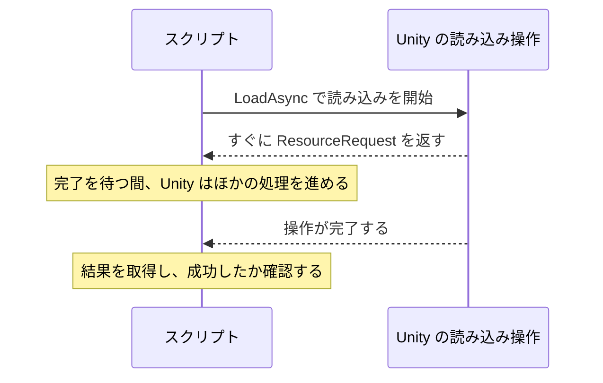

# Unity の非同期操作の完了を待つ

時間や入力だけでなく、Unity が行う読み込みの完了も待てます。テキストファイルを一つ読み込み、操作の開始、完了待ち、結果の取得を分けて考えます。同じ操作をコルーチンと `await` で扱い、進捗の確認にも進みます。

## 学習目標

- 非同期 API の呼び出しと、その完了を待つ処理を区別できる
- `ResourceRequest` を待ち、完了後にテキストを取得できる
- `AsyncOperation` の完了と進捗を調べられる
- 待機のキャンセルと、元の操作の中止を区別できる

## 前提知識

- [非同期処理中の状態を管理する](/unity-csharp-learning/unity/async-state/)を読んでいること

---

## 1. 操作を表すオブジェクトを受け取る

読み込みが必要になるたびに、その処理を自分で別スレッドへ移す必要はありません。Unity の非同期 API は、読み込みを開始し、その操作を表すオブジェクトを返します。そのオブジェクトを使って、完了を待ったり、結果を取得したりします。

このページでは `Resources.LoadAsync` を使います。戻り値の [ResourceRequest](https://docs.unity3d.com/ScriptReference/ResourceRequest.html) は、[AsyncOperation](https://docs.unity3d.com/ScriptReference/AsyncOperation.html) を継承した型です。`AsyncOperation` は、シーンやアセットの読み込みなど、Unity の非同期操作の状態を表します。



### 読み込むテキストを用意する

Project の **Assets** 内に `SampleAsyncAssets` フォルダーを作り、その中に `Resources` フォルダーを作ります。テキストエディターで次のファイルを UTF-8 のプレーンテキストとして保存します。

```text
Assets/SampleAsyncAssets/Resources/SampleAsyncMessage.txt
```

ファイルの内容は次の 1 行です。

```text
Sample async resource loaded.
```

`Resources` は Unity が読み込み対象を探すための特別なフォルダー名です。`LoadAsync` に渡すパスはこのフォルダーからの相対パスで、拡張子を付けません。この例では `SampleAsyncMessage` と指定します。プロジェクト内に複数の `Resources` があっても、同じ参照名のアセットを重複させないようにします。

---

## 2. コルーチンで読み込みの完了を待つ

**書式：[Resources.LoadAsync メソッド](https://docs.unity3d.com/ScriptReference/Resources.LoadAsync.html)**

```csharp
public static ResourceRequest LoadAsync<T>(string path) where T : UnityEngine.Object;
```

| パラメータ・戻り値 | 説明 |
|---|---|
| `T` | 読み込むアセットの型。この例は `TextAsset` |
| `path` | `Resources` からの相対パス。拡張子は付けない |
| 戻り値 | 読み込み操作を表す `ResourceRequest` |

空のゲームオブジェクトに `SampleResourceLoader` スクリプトを作成してアタッチします。

```csharp
using System.Collections;
using UnityEngine;

public class SampleResourceLoader : MonoBehaviour
{
    private IEnumerator Start()
    {
        ResourceRequest request = Resources.LoadAsync<TextAsset>("SampleAsyncMessage");
        Debug.Log("読み込み開始");
        yield return request;

        TextAsset asset = request.asset as TextAsset;
        if (asset == null)
        {
            Debug.LogWarning("テキストを読み込めませんでした");
            yield break;
        }
        Debug.Log(asset.text.Trim());
    }
}
```

```
読み込み開始
Sample async resource loaded.
```

`Resources.LoadAsync` の呼び出しで読み込みが始まります。`yield return request` は、その開始済みの操作が終わるまで、コルーチンの続きを待たせます。指定秒数を待つ必要はありません。

### 完了と成功は同じではない

**書式：[ResourceRequest.asset プロパティ](https://docs.unity3d.com/ScriptReference/ResourceRequest-asset.html)**

```csharp
public UnityEngine.Object asset { get; }
```

完了後の結果は `asset` から取得します。返される型は `UnityEngine.Object` なので、この例では `as TextAsset` でテキストとして受け取っています。パスや型が合わず、目的のアセットを取得できなかった場合は、結果が `null` でないかを確認します。

**書式：[TextAsset.text プロパティ](https://docs.unity3d.com/ScriptReference/TextAsset-text.html)**

```csharp
public string text { get; }
```

`text` がファイルの内容です。例では、ファイル末尾の改行などがログに追加されないよう、文字列の `Trim()` を使っています。

ファイル名を間違えるなどして見つからない状態では、操作自体は完了しても、内容を表示できません。その場合は「テキストを読み込めませんでした」と表示し、結果を使う処理へ進まないようにしています。

---

## 3. 同じ操作を await で待つ

Unity の非同期操作を `Awaitable` に受け渡すと、`await` でも完了を待てます。この例では、コンポーネントが破棄されたときに待機を取りやめられるよう、トークンも渡します。

**書式：[Awaitable.FromAsyncOperation メソッド](https://docs.unity3d.com/ScriptReference/Awaitable.FromAsyncOperation.html)**

```csharp
public static Awaitable FromAsyncOperation(
    AsyncOperation op, CancellationToken cancellationToken = default);
```

| パラメータ・戻り値 | 説明 |
|---|---|
| `op` | 完了を待つ Unity の非同期操作 |
| `cancellationToken` | 待機へキャンセルを伝えるトークン |
| 戻り値 | その操作の完了を待つ `Awaitable` |

```csharp
using System;
using UnityEngine;

public class SampleResourceLoader : MonoBehaviour
{
    private async void Start()
    {
        try
        {
            ResourceRequest request = Resources.LoadAsync<TextAsset>("SampleAsyncMessage");
            Debug.Log("読み込み開始");
            await Awaitable.FromAsyncOperation(request, destroyCancellationToken);

            TextAsset asset = request.asset as TextAsset;
            if (asset == null)
            {
                Debug.LogWarning("テキストを読み込めませんでした");
                return;
            }
            Debug.Log(asset.text.Trim());
        }
        catch (OperationCanceledException)
        {
            Debug.Log("読み込みの待機をキャンセル");
        }
    }
}
```

通常終了時は、2 節と同じ 2 行を表示します。`FromAsyncOperation` は、もう一度読み込みを開始するメソッドではありません。元の `request` が表す操作を待つためのものです。

Unity 6 では、このような `AsyncOperation` を直接 `await` する書き方も使えます。この例では、待機に渡すキャンセルトークンを明示するために `FromAsyncOperation` を使っています。`Task.Run` で `LoadAsync` を包む必要はありません。Unity の API 呼び出しはメインスレッドで行います。

---

## 4. 完了までの進捗を調べる

進捗を表示したい場合は、完了するまで状態を調べます。完了待ちだけが目的なら前の例のままで十分ですが、待機中にも表示を更新したい場合には、このループが役立ちます。

**書式：[AsyncOperation.isDone プロパティ](https://docs.unity3d.com/ScriptReference/AsyncOperation-isDone.html)**

```csharp
public bool isDone { get; }
```

**書式：[AsyncOperation.progress プロパティ](https://docs.unity3d.com/ScriptReference/AsyncOperation-progress.html)**

```csharp
public float progress { get; }
```

`isDone` は操作が完了したか、`progress` は進捗を表します。この読み込みでは、進捗は `0` から `1` の範囲で、完了時には `1` になります。`:P0` は、小数を百分率で表示する文字列の書式です。

```csharp
using System.Collections;
using UnityEngine;

public class SampleResourceLoader : MonoBehaviour
{
    private IEnumerator Start()
    {
        ResourceRequest request = Resources.LoadAsync<TextAsset>("SampleAsyncMessage");
        Debug.Log("読み込み開始");
        while (!request.isDone)
        {
            Debug.Log($"進捗: {request.progress:P0}");
            yield return null;
        }
        Debug.Log($"完了: {request.progress:P0}");

        TextAsset asset = request.asset as TextAsset;
        if (asset == null)
        {
            Debug.LogWarning("テキストを読み込めませんでした");
            yield break;
        }
        Debug.Log(asset.text.Trim());
    }
}
```

実行結果の例です。小さなファイルや読み込み済みのアセットではすぐに完了し、「進捗」の行が出ないこともあります。途中の行数と値は固定ではありません。百分率の空白などは実行環境の書式設定でも変わります。

```
読み込み開始
進捗: 0%
完了: 100%
Sample async resource loaded.
```

`progress` の増え方が一定とは限らず、経過秒数の割合でもありません。また、シーン読み込みなど、別の `AsyncOperation` では操作固有の進捗や有効化の仕組みがあります。この例の進捗の扱いを、すべての操作にそのまま当てはめないようにします。

## 動作確認

3 種類のコードで、最後に同じテキストが表示されることを確認します。進捗版では、途中のログがなくても、完了が 100% で内容が表示されれば読み込みは完了しています。

次に、ファイルを `Resources` の外へ一時的に移して確認します。「テキストを読み込めませんでした」と表示され、内容を使おうとして例外にならないことを確認します。確認後は元の位置に戻します。進捗が 100% になっても、目的の結果を取得できたかは別に調べる必要があります。

---

## よくあるミス

### 待機のキャンセルを、読み込みの中止や解放と同じと考える

コルーチンを止めたり、待機へキャンセルを伝えたりしても、それだけで元の操作の中止やアセットの解放まで行ったと考えてはいけません。`ResourceRequest` には、読み込みを中止する公開の `Cancel` メソッドはありません。中止できるかは元の API の仕様を確認し、待たなくなった結果を使わないことも含めて設計します。

また、待機が終了したことと、読み込んだアセットが不要になったことも違います。アセットをいつ保持・解放するかは、使う期間に合わせて別に管理します。

---

## まとめ

- 非同期 API の呼び出しで操作が始まり、返されたオブジェクトで完了や結果を扱う
- `ResourceRequest` はコルーチンで待てる。`FromAsyncOperation` を使って `await` でも待てる
- 完了したことと、目的のアセットが得られたことは区別する
- 進捗の更新頻度や途中の値は固定ではなく、操作ごとの仕様を確認する

## 理解度チェック

1. 読み込みを始めるのは、`LoadAsync` と `yield return request` のどちらですか？
2. この例で `SampleAsyncMessage.txt` ではなく `SampleAsyncMessage` と指定するのはなぜですか？
3. 操作が完了しても、`asset` を確認する必要があるのはなぜですか？
4. 進捗の途中の行が出なかったら、必ず失敗ですか？

<details markdown="1">
<summary>解答を見る</summary>

1. `LoadAsync` です。`yield return` は開始済みの操作の完了を待ちます。
2. `Resources` 内のアセットは、拡張子を除いた相対パスで指定するためです。
3. パスや型が合わず、目的の結果を取得できていない場合があるためです。
4. 失敗とは限りません。小さなアセットなどでは、進捗を表示する前に完了する場合があります。

</details>

## 次のステップ

[Unity から通信する](/unity-csharp-learning/networking/unity-webrequest/)では、通信操作を開始し、応答をコルーチンや `await` で待ちます。開始・完了・結果の確認を分ける考え方は同じです。
