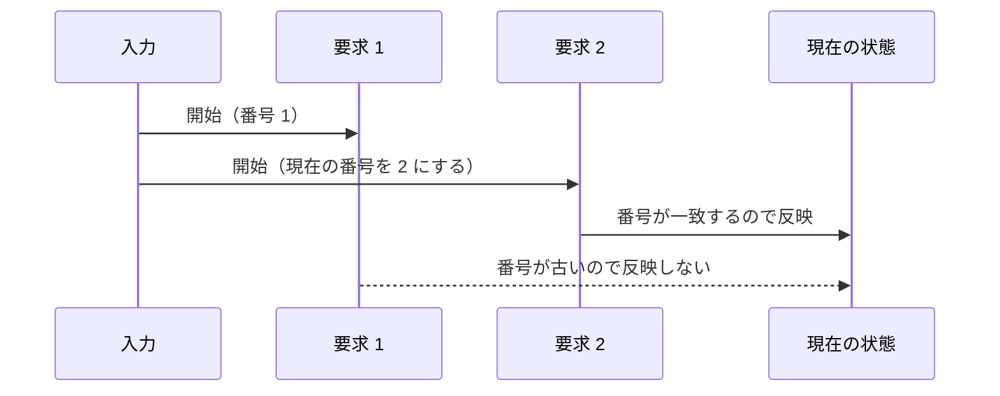

# 非同期処理中の状態を管理する

待機中も入力やほかの処理は進みます。その間に同じ操作をもう一度要求されたら、今の処理を続けるべきでしょうか。要求を受け付けない、前の処理を取り消す、古い結果を使わない、という三つの方針を比較します。

## 学習目標

- メインスレッドだけでも、待機を挟むと複数の処理が入り交じることを説明できる
- 実行中の要求を無視する方法と、新しい要求へ切り替える方法を使い分けられる
- 完了順が逆転しても、古い結果で新しい状態を上書きしないようにできる
- 信号機の状態に応じて、要求を受け付ける期間を決められる

## 前提知識

- [複数の処理を開始して待つ](/unity-csharp-learning/unity/concurrent-operations/)を読んでいること
- [Input System で入力操作](/unity-csharp-learning/unity/input-system/)を読んでいること（設定済み）

---

## 1. 待っている間にも、次の要求は届く

1 秒後に結果を表示する処理を考えます。1 秒以内にもう一度キーを押すと、最初の処理が終了していなくても、次の処理を開始できます。`await` は、そのメソッドを中断するものであり、次の入力を禁止するものではないためです。

空のゲームオブジェクトに `SampleAsyncState` スクリプトを作成してアタッチします。`Update` は Input System で Space キーを調べ、押されるたびに入力の入口である `Request` を呼びます。番号は要求を区別するためのものです。

```csharp
using System;
using UnityEngine;
using UnityEngine.InputSystem;

public class SampleAsyncState : MonoBehaviour
{

    private int _requestId;

    private void Update()
    {
        var keyboard = Keyboard.current;
        if (keyboard != null && keyboard.spaceKey.wasPressedThisFrame) Request();
    }

    private void Request()
    {
        Run(++_requestId);
    }

    private async void Run(int id)
    {
        try
        {
            Debug.Log($"{id}: 開始");
            await Awaitable.WaitForSecondsAsync(1f, destroyCancellationToken);
            Debug.Log($"{id}: 完了");
        }
        catch (OperationCanceledException)
        {
            Debug.Log($"{id}: キャンセル");
        }
    }
}
```

1 秒以内に Space キーを 2 回押したときの実行結果の例です。Game ビューをクリックしてから入力します。押した間隔によって表示時刻は変わります。

```
1: 開始
2: 開始
1: 完了
2: 完了
```

すべてメインスレッドでも、1 の待機中に 2 が開始しています。最初の処理が「開始したときの状態」のまま完了できるとは限りません。これが、待機を含む処理で状態を管理する必要がある理由です。

`Update` 自体を `async` にして待っても、次のフレームの `Update` が呼ばれなくなるわけではありません。開始を許可する条件は、自分で用意します。

---

## 2. 実行中の要求を受け付けない

演出を一度最後まで進めたい場合は、実行中の要求を断る方針が使えます。`_isRunning` を待機より前に `true` にし、正常終了・キャンセル・例外のどの場合も `finally` で戻します。

```csharp
using System;
using UnityEngine;
using UnityEngine.InputSystem;

public class SampleAsyncState : MonoBehaviour
{

    private int _requestId;
    private bool _isRunning;

    private void Update()
    {
        var keyboard = Keyboard.current;
        if (keyboard != null && keyboard.spaceKey.wasPressedThisFrame) Request();
    }

    private void Request()
    {
        int id = ++_requestId;
        if (_isRunning)
        {
            Debug.Log($"{id}: 無視");
            return;
        }
        _isRunning = true;
        Run(id);
    }

    private async void Run(int id)
    {
        try
        {
            Debug.Log($"{id}: 開始");
            await Awaitable.WaitForSecondsAsync(1f, destroyCancellationToken);
            Debug.Log($"{id}: 完了");
        }
        catch (OperationCanceledException)
        {
            Debug.Log($"{id}: キャンセル");
        }
        finally
        {
            _isRunning = false;
        }
    }
}
```

1 秒以内に 2 回押した場合のログです。

```
1: 開始
2: 無視
1: 完了
```

完了後にもう一度押すと、新しい番号で開始できます。判定と `true` の代入を、最初の待機より前に行うことが大切です。待ってから実行中にすると、その間に次の要求が通ってしまいます。

---

## 3. 前の処理をキャンセルして、新しい要求へ切り替える

検索条件の変更など、以前の要求より新しい要求を優先したい場合があります。前の処理へキャンセルを伝え、新しい処理には新しいソースを渡します。

```csharp
using System;
using System.Threading;
using UnityEngine;
using UnityEngine.InputSystem;

public class SampleAsyncState : MonoBehaviour
{

    private int _requestId;
    private CancellationTokenSource _current;

    private void Update()
    {
        var keyboard = Keyboard.current;
        if (keyboard != null && keyboard.spaceKey.wasPressedThisFrame) Request();
    }

    private void Request()
    {
        _current?.Cancel();
        var source = CancellationTokenSource.CreateLinkedTokenSource(destroyCancellationToken);
        _current = source;
        Run(++_requestId, source);
    }

    private async void Run(int id, CancellationTokenSource source)
    {
        try
        {
            Debug.Log($"{id}: 開始");
            await Awaitable.WaitForSecondsAsync(1f, source.Token);
            Debug.Log($"{id}: 完了");
        }
        catch (OperationCanceledException)
        {
            Debug.Log($"{id}: キャンセル");
        }
        finally
        {
            if (ReferenceEquals(_current, source)) _current = null;
            source.Dispose();
        }
    }
}
```

1 秒以内に 2 回押したときの実行結果の例です。最初の処理は取り消され、2 の完了だけを受け取ります。キャンセル通知と新しい処理の開始が表示される前後関係は、待機する API の動作によって変わり得ます。

```
1: 開始
1: キャンセル
2: 開始
2: 完了
```

終了した処理は、引数で受け取った自分のソースを破棄します。`ReferenceEquals` は、まだそのソースが現在の処理のものかを調べています。以前の処理の `finally` が遅れて実行されても、新しい処理の参照を消さないためです。

取り消しを受け付けない操作まで、この方法で中止できるわけではありません。次は、完了した結果を採用するかどうかを判断する方法です。

---

## 4. 古い結果を反映しない

最初の要求が遅く、後から出した要求が先に完了することがあります。完了した順にそのまま表示へ反映すると、最後に古い結果が残ってしまいます。

新しい要求のたびに番号を増やし、開始時の番号をローカル変数として保持します。待機後に現在の番号と比べ、一致する要求の結果だけを採用します。次の例は、奇数の要求を 1 秒、偶数の要求を 0.3 秒待たせ、完了順の逆転を再現します。

```csharp
using System;
using UnityEngine;
using UnityEngine.InputSystem;

public class SampleAsyncState : MonoBehaviour
{

    private int _version;

    private void Update()
    {
        var keyboard = Keyboard.current;
        if (keyboard != null && keyboard.spaceKey.wasPressedThisFrame) Request();
    }

    private void Request()
    {
        Run(++_version);
    }

    private async void Run(int version)
    {
        try
        {
            Debug.Log($"{version}: 開始");
            float seconds = version % 2 == 1 ? 1f : 0.3f;
            await Awaitable.WaitForSecondsAsync(seconds, destroyCancellationToken);
            if (version != _version)
            {
                Debug.Log($"{version}: 古い結果を破棄");
                return;
            }
            Debug.Log($"{version}: 結果を反映");
        }
        catch (OperationCanceledException)
        {
            Debug.Log($"{version}: キャンセル");
        }
    }
}
```

約 0.2 秒間隔で 2 回押したときの実行結果の例です。入力間隔が長ければ、最初の結果が新しい要求より先に反映されることもあります。

```
1: 開始
2: 開始
2: 結果を反映
1: 古い結果を破棄
```

新しい要求では前の待機をキャンセルしていません。コンポーネント破棄時のキャンセルは別に残しています。「不要になった結果を反映しない」ことと「その計算や通信を止める」ことは違います。



## 5. 実例：信号機が要求を受け付ける期間を決める

[Awaitable の信号機](/unity-csharp-learning/unity/awaitable/#6-実例前のページの信号機を書き換える)に、2 節の「実行中の要求を受け付けない」方針を適用します。信号機では、一度始めた青・点滅の手順を、次の要求のたびに取り消す必要はありません。

`_isAcceptingRequest` は、赤で要求を待っている期間だけ `true` にします。要求を受け取って手順を進めるときに `false` にし、青・点滅中や電源が切れている間の要求は無視します。赤に戻ったら、改めて要求を受け付けます。

最小例のスクリプトを外し、球体 `Signal` の `CoroutineSignal` を次の全体コードにします。Space キーで要求し、P キーで停止・再開始します。時間切れの案内と、点滅回数の検証も残しています。

### 完成したコード

```csharp
using System;
using System.Threading;
using UnityEngine;
using UnityEngine.InputSystem;

public class CoroutineSignal : MonoBehaviour
{
    [SerializeField] private float _guideInterval = 5f;
    [SerializeField] private int _blinkCount = 2;

    private Renderer _renderer;
    private bool _isRequested;
    private bool _isAcceptingRequest;
    private CancellationToken _lifetimeToken;
    private CancellationTokenSource _powerSource;

    private void Start()
    {
        _renderer = GetComponent<Renderer>();
        _lifetimeToken = destroyCancellationToken;
        PowerOn();
    }

    private void Update()
    {
        var keyboard = Keyboard.current;
        if (keyboard == null) return;

        if (keyboard.spaceKey.wasPressedThisFrame)
        {
            RequestGreen();
        }

        if (keyboard.pKey.wasPressedThisFrame)
        {
            TogglePower();
        }
    }

    public void RequestGreen()
    {
        if (!_isAcceptingRequest)
        {
            Debug.Log($"{Time.time:F2} 秒: 要求を受け付けない");
            return;
        }
        Debug.Log($"{Time.time:F2} 秒: 切り替え要求");
        _isRequested = true;
    }

    public void TogglePower()
    {
        if (_powerSource != null)
        {
            _powerSource.Cancel();
        }
        else
        {
            PowerOn();
        }
    }

    private async void PowerOn()
    {
        if (_powerSource != null) return;
        _isRequested = false;
        var source = CancellationTokenSource.CreateLinkedTokenSource(_lifetimeToken);
        _powerSource = source;
        try
        {
            await RunSignal(source.Token);
        }
        catch (OperationCanceledException)
        {
            Debug.Log($"{Time.time:F2} 秒: 停止");
        }
        finally
        {
            if (ReferenceEquals(_powerSource, source)) _powerSource = null;
            source.Dispose();
        }
    }

    private async Awaitable RunSignal(CancellationToken token)
    {
        try
        {
            while (true)
            {
                SetColor(Color.red, "赤");
                _isAcceptingRequest = true;

                while (!await WaitForRequest(_guideInterval, token))
                {
                    Debug.Log($"{Time.time:F2} 秒: 案内「Space キーを押してください」");
                }
                _isRequested = false;
                _isAcceptingRequest = false;

                await Awaitable.WaitForSecondsAsync(1f, token);

                SetColor(Color.blue, "青");
                await Awaitable.WaitForSecondsAsync(2f, token);

                try
                {
                    await Blink(_blinkCount, token);
                }
                catch (ArgumentOutOfRangeException e)
                {
                    Debug.LogWarning($"{Time.time:F2} 秒: 点滅できなかったので、1 秒待つ（{e.GetType().Name}）");
                    await Awaitable.WaitForSecondsAsync(1f, token);
                }
            }
        }
        finally
        {
            _isAcceptingRequest = false;
            if (!_lifetimeToken.IsCancellationRequested) SetColor(Color.black, "消灯");
        }
    }

    private async Awaitable<bool> WaitForRequest(float timeout, CancellationToken token)
    {
        float deadline = Time.time + timeout;
        while (!_isRequested && Time.time < deadline)
        {
            await Awaitable.NextFrameAsync(token);
        }
        return _isRequested;
    }

    private async Awaitable Blink(int count, CancellationToken token)
    {
        if (count < 1)
        {
            throw new ArgumentOutOfRangeException(nameof(count), "点滅の回数は 1 以上にしてください");
        }

        for (int i = 0; i < count; i++)
        {
            SetColor(Color.gray, "灰");
            await Awaitable.WaitForSecondsAsync(0.25f, token);

            SetColor(Color.blue, "青");
            await Awaitable.WaitForSecondsAsync(0.25f, token);
        }
    }

    private void SetColor(Color color, string label)
    {
        _renderer.material.color = color;
        Debug.Log($"{Time.time:F2} 秒: {label}");
    }
}
```

`RequestGreen` の入口で状態を調べるため、忙しい間の入力が次の赤の要求として残りません。また、操作用のソースは実行ごとにローカル変数で持ち、終了した実行自身が破棄します。破棄時は、色を変える後片付けも取りやめます。

## 動作確認

赤で Space キーを押し、青や点滅の間にもう一度押します。Console に「要求を受け付けない」と表示されます。赤に戻っても自動で青へ進まず、次に Space キーを押すまで待つことを確認します。何も押さず 5 秒たつと、これまでどおり案内が出ます。

P キーで停止し、Space キーを押しても要求は受け付けません。P キーで再開始すると赤へ戻り、Space キーによる要求を受け付けます。

---

## まとめ

| 方針 | 向いている場面 |
|---|---|
| 実行中の要求を無視する | 一つの操作を最後まで進めたい |
| 前の処理をキャンセルする | 新しい条件の処理に切り替えたい |
| 古い結果を反映しない | 操作自体を止められなくても、表示や状態を最新に保ちたい |

どれもメインスレッド上で必要になる状態管理です。キャンセルに対応した処理では、取り消しと結果の番号確認を組み合わせることもできます。

## 理解度チェック

1. 待機している間、次の入力を自動で禁止できますか？
2. 古い処理の `finally` で、現在の処理の参照を無条件に `null` にすると何が起きますか？
3. 4 節は、古い処理そのものを中止していますか？

<details markdown="1">
<summary>解答を見る</summary>

1. できません。入力の受付条件や実行中の状態を自分で管理します。
2. すでに新しい処理が始まっている場合、その参照まで消す可能性があります。
3. 中止していません。終了後、その結果を現在の状態へ反映しないようにしています。

</details>

## 次のステップ

[Unity の非同期操作の完了を待つ](/unity-csharp-learning/unity/async-operations/)では、実際の読み込み操作の開始・進捗・完了と、結果を使うタイミングを学びます。
