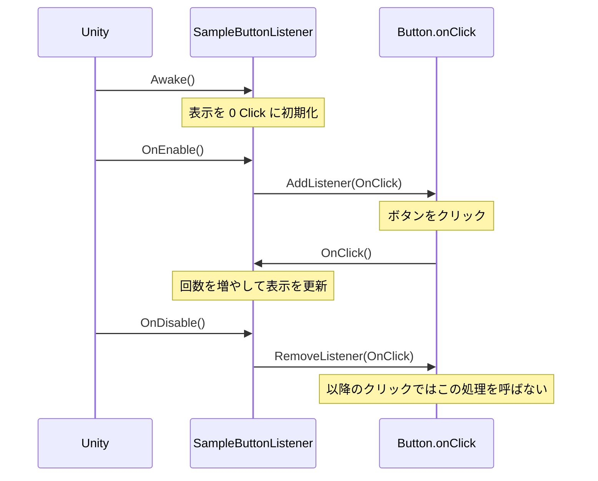
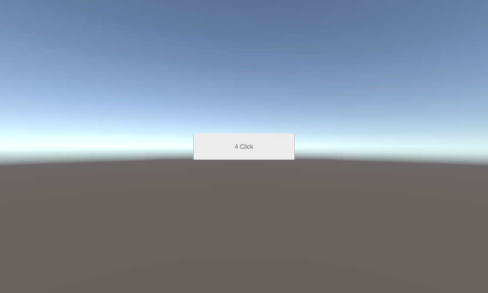
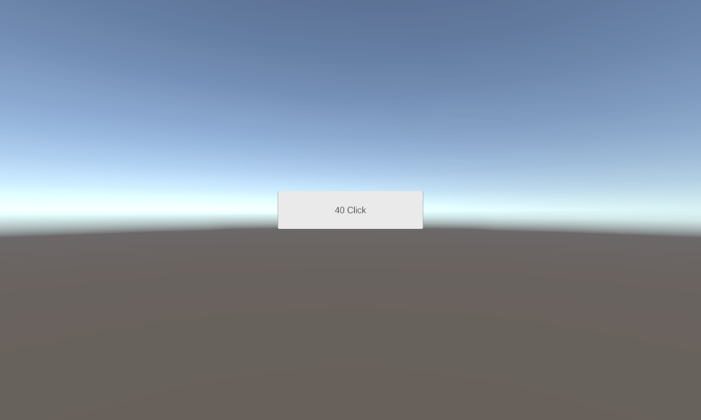

# 補足: ボタンのクリック処理をスクリプトから登録する

[Unity UI とボタン操作](/unity-csharp-learning/unity/unity-ui/) では、Inspector の **On Click ()** からクリック時の処理を登録しました。このページでは、同じクリックカウンターを `AddListener` で登録し、有効な間だけ反応させます。登録する処理の型である `UnityAction` と、ラムダ式で引数付きの処理を呼ぶ方法も学びます。

## 学習目標

- `AddListener` と `RemoveListener` でクリック時の処理を登録・解除できる
- `onClick`、`UnityEvent`、`UnityAction` の役割を説明できる
- ラムダ式で登録した処理を保存し、同じ処理を解除できる

## 前提知識

- [Unity UI とボタン操作](/unity-csharp-learning/unity/unity-ui/) の最後まで進め、クリック回数を表示するボタンを作っていること
- [Unity のメッセージと実行順序](/unity-csharp-learning/unity/messages/) で `Awake`、`OnEnable`、`OnDisable` を学んでいること
- [デリゲートの基本](/unity-csharp-learning/csharp/delegates/) を読んでいること。後半では [ラムダ式](/unity-csharp-learning/csharp/lambda/) も使います

---

## 1. 元のボタンを準備する

前のページで作ったシーンを開き、**File → Save As** で `SampleButtonListeners` という名前の別シーンに保存します。元の `Clicker.cs` は変更せず、補足ページ用のスクリプトを作ります。

1. Hierarchy で **Button** ゲームオブジェクトを選択する。
2. **Button** コンポーネントの **On Click ()** にある `Clicker.OnClick` の行を選択し、**−** ボタンで削除する。このページでは登録欄を空にする。
3. **Clicker** コンポーネントのメニューから **Remove Component** を選択する。
4. **Add Component → New script** から `SampleButtonListener` を作成してアタッチする。

Canvas、EventSystem、Button コンポーネント、子の **Text (TMP)** は残してください。Inspector の登録とコードの登録を両方残すと、両方の処理が呼ばれます。

---

## 2. AddListener と RemoveListener

`SampleButtonListener.cs` を次の全体のコードに書き換えます。

```csharp
using TMPro;
using UnityEngine;
using UnityEngine.UI;

public class SampleButtonListener : MonoBehaviour
{
    [SerializeField] private Button _button;
    [SerializeField] private TMP_Text _content;
    private int _count;

    private void Awake()
    {
        UpdateText();
    }

    private void OnEnable()
    {
        _button.onClick.AddListener(OnClick);
    }

    private void OnDisable()
    {
        _button.onClick.RemoveListener(OnClick);
    }

    private void OnClick()
    {
        _count++;
        Debug.Log($"OnClick: {_count}", this);
        UpdateText();
    }

    private void UpdateText()
    {
        _content.text = $"{_count} Click";
    }
}
```

保存してコンパイルが終わったら、Inspector の **Sample Button Listener** で次の参照を設定してください。

| 欄 | 設定するもの |
|---|---|
| Button | 同じゲームオブジェクトの **Button** コンポーネント |
| Content | Button の子にある **Text (TMP)** |

**書式：[Button.onClick プロパティ](https://docs.unity3d.com/Packages/com.unity.ugui@2.0/api/UnityEngine.UI.Button.html#UnityEngine_UI_Button_onClick)**

```csharp
public Button.ButtonClickedEvent onClick { get; set; }
```

`onClick` はクリック時に呼び出す処理を管理するイベントです。型の `ButtonClickedEvent` は、引数のない `UnityEvent` を継承しています。ここで使う Button は **UnityEngine.UI.Button（uGUI）** です。

**書式：[UnityEvent.AddListener メソッド](https://docs.unity3d.com/ScriptReference/Events.UnityEvent.AddListener.html)**

```csharp
public void AddListener(UnityAction call);
```

| パラメータ | 説明 |
|---|---|
| `call` | イベントが発生したときに呼び出す処理 |

`AddListener(OnClick)` は、`OnClick` をクリック時の処理として登録します。`OnClick()` と書くとその場でメソッドを呼び出してしまうので、渡すときには括弧を付けません。

コードから登録する場合は `private` メソッドも使えます。前のページで `public` が必要だったのは、Inspector の候補に表示するためです。

**書式：[UnityEvent.RemoveListener メソッド](https://docs.unity3d.com/ScriptReference/Events.UnityEvent.RemoveListener.html)**

```csharp
public void RemoveListener(UnityAction call);
```

| パラメータ | 説明 |
|---|---|
| `call` | 登録を解除する処理 |

この例では、スクリプトが有効になるたびに `OnEnable` で登録し、無効になるときに `OnDisable` で解除します。スクリプトを無効にするだけでは、イベントに登録した処理は解除されません。有効な間だけクリックに反応させるために、登録と解除を対にしています。



Inspector で保存した登録を「永続的なリスナー」、`AddListener` で実行時に追加する登録を「非永続的なリスナー」と呼びます。`RemoveListener` で解除できるのは後者です。Inspector の登録は、手順 1 のように Inspector で削除してください。コードからの登録は **On Click ()** の保存済みの一覧には追加されず、Play を終了すると失われます。

---

## 3. UnityAction は登録する処理の型

**書式：[UnityAction デリゲート](https://docs.unity3d.com/ScriptReference/Events.UnityAction.html)**

```csharp
public delegate void UnityAction();
```

`UnityAction` は `UnityEngine.Events` 名前空間にある、**引数なし・戻り値なし**のデリゲート型です。`AddListener` の引数がこの型なので、前の例の `OnClick` は `UnityAction` に変換されて渡されます。毎回 `UnityAction` 型の変数を宣言する必要はありません。

| 名前 | 役割 |
|---|---|
| `Button.onClick` | ボタンのクリック時に呼び出す処理を管理するイベント |
| `UnityEvent` | 処理を登録・解除し、イベント発生時に呼び出す仕組み |
| `UnityAction` | 登録する処理を表すデリゲート型 |

C# の `Action` と同じ形ですが、別の型です。`Action` 型の変数をそのまま `AddListener` に渡せるわけではありません。また、`onClick` は C# の `event` キーワードで宣言されたイベントではないため、登録・解除には `+=` / `-=` ではなく `AddListener` / `RemoveListener` を使います。

`UnityAction<T>` のような引数付きの型もありますが、ボタンの `onClick` は引数を渡しません。次の節では、引数なしのラムダ式の中から、引数付きのメソッドを呼び出します。

---

## 4. ラムダ式を保存して登録する

クリックのたびに 10 ずつ増やすようにしてみましょう。`SampleButtonListener.cs` を次の全体のコードに置き換えます。クラス名と Inspector の参照は同じなので、コンポーネントを追加し直す必要はありません。**Play を停止してから**書き換えてください。

```csharp
using TMPro;
using UnityEngine;
using UnityEngine.Events;
using UnityEngine.UI;

public class SampleButtonListener : MonoBehaviour
{
    [SerializeField] private Button _button;
    [SerializeField] private TMP_Text _content;
    private UnityAction _clickAction;
    private int _count;

    private void Awake()
    {
        _clickAction = () => AddCount(10);
        UpdateText();
    }

    private void OnEnable()
    {
        _button.onClick.AddListener(_clickAction);
    }

    private void OnDisable()
    {
        _button.onClick.RemoveListener(_clickAction);
    }

    private void AddCount(int amount)
    {
        _count += amount;
        Debug.Log($"AddCount: {_count}", this);
        UpdateText();
    }

    private void UpdateText()
    {
        _content.text = $"{_count} Click";
    }
}
```

`() => AddCount(10)` は、呼び出されたときに `AddCount(10)` を実行する、引数なし・戻り値なしのラムダ式です。登録する時点では `AddCount` は呼ばれません。この例では、表示の形式を前の例とそろえ、カウントだけを 10 ずつ増やしています。

解除するときに登録したものと同じデリゲートを渡せるよう、`Awake` で一度作り、`_clickAction` に保存しています。`OnEnable` と `OnDisable` にそれぞれ同じ見た目のラムダ式を書いても、別々の式から作ったデリゲートが同じとは限らないため、解除には使わないでください。

ボタンごとに異なる引数を渡す方法は、実行中にボタンを生成するときにも使えます。`for` ループで登録する場合は、ループ変数の共有に注意が必要です。詳しくは [変数キャプチャ](/unity-csharp-learning/csharp/variable-capture/) を参照してください。

---

## 動作確認

まず節 2 の名前付きメソッドのコードで確認し、その後 Play を停止して節 4 のラムダ式のコードに置き換え、同じ手順で確認します。

1. **Button** の **On Click ()** が空で、**Clicker** コンポーネントがなく、**Sample Button Listener** が 1 つだけ付いていることを確認する。
2. **Sample Button Listener** の **Button** と **Content** が設定され、コンポーネントが有効になっていることを確認する。
3. Console を消去し、Play を開始する。ボタンの表示が `0 Click` になる。
4. Game ビューでボタンを 2 回クリックする。Console とボタンの表示を、下の表と照合する。
5. Play 中に Inspector で **Sample Button Listener** の見出し左のチェックを外す。Button コンポーネントとゲームオブジェクトは有効なままにする。
6. ボタンをクリックする。Console に新しいカウントのログは出ず、表示も変わらない。
7. **Sample Button Listener** に再びチェックを入れ、ボタンを 1 回クリックする。カウントが続きから 1 回分だけ増える。
8. チェックを外して入れる操作をもう一度行い、ボタンを 1 回クリックする。今回も 1 回分だけ増える。
9. Play を停止し、もう一度開始する。`0 Click` に戻り、クリックで再び増えることを確認する。

| 確認する時点 | 節 2：名前付きメソッド | 節 4：ラムダ式 |
|---|---|---|
| 1 回目のクリック | ログ `OnClick: 1`、表示 `1 Click` | ログ `AddCount: 10`、表示 `10 Click` |
| 2 回目のクリック | ログ `OnClick: 2`、表示 `2 Click` | ログ `AddCount: 20`、表示 `20 Click` |
| 無効にしてクリック | ログなし、表示 `2 Click` のまま | ログなし、表示 `20 Click` のまま |
| 再び有効にしてクリック | ログ `OnClick: 3`、表示 `3 Click` | ログ `AddCount: 30`、表示 `30 Click` |
| もう一度無効・有効にしてクリック | ログ `OnClick: 4`、表示 `4 Click` | ログ `AddCount: 40`、表示 `40 Click` |

手順 8 まで進めた名前付きメソッド版の表示です。



同じ操作をラムダ式版で行うと、10 ずつ増えて `40 Click` になります。



---

## よくあるミス

### 参照が未設定でエラーになる

**Sample Button Listener** の **Button** と **Content** を確認してください。このページのコードは、Inspector で両方の参照を設定してから実行する前提です。

### 無効にしてもクリック時の処理が動く

Inspector の **On Click ()** の登録や、元の **Clicker** コンポーネントが残っていないか確認してください。`RemoveListener` は Inspector の登録を解除しません。また、登録したラムダ式を保存せず、解除時に新しいラムダ式を書いていないか確認してください。

### 有効にし直すと回数が 0 に戻ると思っていた

`Awake` は同じインスタンスに対して 1 回だけ呼ばれます。コンポーネントのチェックを付け直しても `_count` は維持され、`OnEnable` は処理の登録だけを行います。Play を停止して再開すると、新しいインスタンスで 0 から始まります。

---

## まとめ

- `onClick.AddListener` で処理を登録し、`RemoveListener` で解除する
- 有効な間だけ反応させる場合は、`OnEnable` と `OnDisable` で登録と解除を対にする
- `UnityAction` は処理を表すデリゲート型で、`UnityEvent` は登録された処理を管理して呼び出す仕組み
- ラムダ式を解除するときは、登録するデリゲートを保存して同じものを渡す
- Inspector の登録はコードからの登録と区別し、Inspector で削除する

---

## 理解度チェック

1. `AddListener` にメソッドを渡すとき、メソッド名に括弧を付けないのはなぜですか？
2. ボタンの `onClick` に登録する、型引数のない `UnityAction` は、どのような引数と戻り値を持ちますか？
3. ラムダ式で登録した処理を、無効になるときに解除するにはどうしますか？
4. `RemoveListener` を呼んでも、Inspector で登録した処理が残るのはなぜですか？

<details markdown="1">
<summary>解答を見る</summary>

1. その場で呼び出すのではなく、後で呼び出す処理をデリゲートとして渡すためです。
2. 引数なし、戻り値なし（`void`）です。
3. ラムダ式から作ったデリゲートを `UnityAction` 型のフィールドなどに保存し、登録時と解除時に同じものを渡します。
4. `RemoveListener` は、実行時に追加した非永続的なリスナーを解除する API だからです。Inspector の永続的なリスナーは Inspector で削除します。

</details>

---

## 次のステップ

[Layout Group による自動配置](/unity-csharp-learning/unity/layout-group/) と組み合わせると、ボタンを並べるメニューに応用できます。実行中に生成するボタンでも、`AddListener` でクリック時の処理を登録できます。

## 参考

- [UnityEvent](https://docs.unity3d.com/ScriptReference/Events.UnityEvent.html)
- [UnityAction](https://docs.unity3d.com/ScriptReference/Events.UnityAction.html)
- [UnityEvent.AddListener](https://docs.unity3d.com/ScriptReference/Events.UnityEvent.AddListener.html)
- [UnityEvent.RemoveListener](https://docs.unity3d.com/ScriptReference/Events.UnityEvent.RemoveListener.html)
