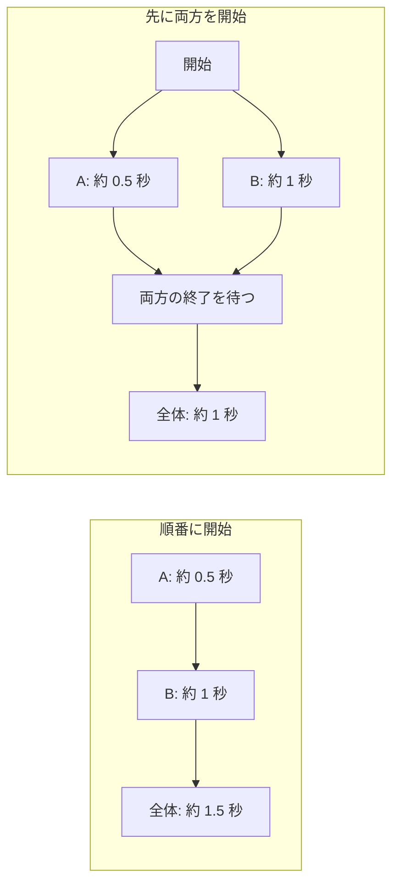

# 複数の処理を開始して待つ

二つの処理が終わってから次へ進みたい場合、開始する順序によって全体の待ち時間が変わります。「一つ終わってから次を始める」と「先に両方を始める」をログで比較し、コルーチンと `Task.WhenAll` で書いてみます。

## 学習目標

- 順番に開始する処理と、先に複数を開始してから待つ処理を区別できる
- 複数のコルーチンの終了を待てる
- Awaitable を一度ずつ待って `Task` に受け渡し、`Task.WhenAll` で全体の終了を待てる
- 同時進行と別スレッドでの並列実行を区別できる

## 前提知識

- [補足：Unity のメインスレッドと別スレッド](/unity-csharp-learning/unity/main-thread/)を読んでいること
- [複数の Task を待つ](/unity-csharp-learning/csharp/task-whenall/)を読んでいること

---

## 1. 一つ終わってから次を開始する

たとえば、演出 A の終了後に演出 B を始めるなら、その順序を守る必要があります。一方、互いに依存しない二つの演出なら、両方を先に始めて、そろって終わるのを待ちたいこともあります。まず、ログと時間待ちだけで、この違いを調べます。

空のゲームオブジェクトに、動作確認用の `SampleConcurrent` スクリプトを作成してアタッチします。A は約 0.5 秒、B は約 1 秒の処理です。

```csharp
using System.Collections;
using UnityEngine;

public class SampleConcurrent : MonoBehaviour
{
    private IEnumerator Start()
    {
        yield return Work("A", 0.5f);
        yield return Work("B", 1f);
        Debug.Log("すべて終了");
    }

    private IEnumerator Work(string label, float seconds)
    {
        Debug.Log($"{label}: 開始");
        yield return new WaitForSeconds(seconds);
        Debug.Log($"{label}: 終了");
    }
}
```

```
A: 開始
A: 終了
B: 開始
B: 終了
すべて終了
```

`yield return Work("A", ...)` の次へ進むのは、A が終了してからです。B の待機もその後から始まるため、全体では約 1.5 秒かかります。フレーム単位で再開するため、実際の所要時間には誤差があります。

---

## 2. 先に両方を開始してから待つ

A の結果が B の開始に必要ないなら、B を始めるために A の終了を待つ必要はありません。`StartCoroutine` で両方を開始し、それぞれの `Coroutine` を保存します。

```csharp
using System.Collections;
using UnityEngine;

public class SampleConcurrent : MonoBehaviour
{
    private IEnumerator Start()
    {
        Coroutine a = StartCoroutine(Work("A", 0.5f));
        Coroutine b = StartCoroutine(Work("B", 1f));
        yield return a;
        yield return b;
        Debug.Log("すべて終了");
    }

    private IEnumerator Work(string label, float seconds)
    {
        Debug.Log($"{label}: 開始");
        yield return new WaitForSeconds(seconds);
        Debug.Log($"{label}: 終了");
    }
}
```

通常のフレームレートでの実行結果の例です。A・B の開始後、両方が終了してから「すべて終了」が表示されます。終了が同じフレームに重なる場合、A・B の終了ログの順序は保証されません。

```
A: 開始
B: 開始
A: 終了
B: 終了
すべて終了
```

`yield return a` で親が待っている間も、開始済みの B は進みます。`yield return b` は、B を新しく開始する指定ではありません。B が終わっていれば、その待機はすでに満たされています。

全体の待ち時間は約 1 秒となり、約 0.5 秒と約 1 秒を足した長さにはなりません。違いを決めているのは、待つ行の数ではなく、**いつ各処理を開始したか**です。



この例のコードは、どちらの処理もメインスレッドで動きます。待機中にもう一方を進められるのであり、二つの CPU コアで同時に計算しているという意味ではありません。

また、A・B は独立して開始したコルーチンです。親が待つのをやめたり、親だけを停止したりしても、A・B 全体を取り消したことにはなりません。[親子の停止範囲](/unity-csharp-learning/unity/coroutine-control/#親を止めたら子も止まるのか)も参照してください。

---

## 3. Task.WhenAll で全体の終了を待つ

`Task.WhenAll` は、複数の `Task` の完了をまとめて表す `Task` を返します。渡した処理をこのメソッドが開始するわけではありません。

**書式：[Task.WhenAll メソッド](https://learn.microsoft.com/dotnet/api/system.threading.tasks.task.whenall)**

```csharp
public static Task WhenAll(params Task[] tasks);
```

| パラメータ・戻り値 | 説明 |
|---|---|
| `tasks` | 完了を待つ `Task`。すでに開始した処理のものを渡す |
| 戻り値 | すべての完了を表す `Task` |

Unity の秒数待ちは `Awaitable` なので、[前の説明](/unity-csharp-learning/unity/awaitable/#一度だけ開始した処理の完了を共有したい場合)と同じ `ToTask` を定義します。元の `Awaitable` はこのメソッドで一度だけ待ち、`WhenAll` には受け渡した `Task` を渡します。

```csharp
using System;
using System.Threading;
using System.Threading.Tasks;
using UnityEngine;

public class SampleConcurrent : MonoBehaviour
{
    private async void Start()
    {
        CancellationToken token = destroyCancellationToken;
        try
        {
            Task a = ToTask(Work("A", 0.5f, token));
            Task b = ToTask(Work("B", 1f, token));
            await Task.WhenAll(a, b);
            Debug.Log("すべて終了");
        }
        catch (OperationCanceledException)
        {
            Debug.Log("キャンセル");
        }
    }

    private async Awaitable Work(string label, float seconds, CancellationToken token)
    {
        Debug.Log($"{label}: 開始");
        await Awaitable.WaitForSecondsAsync(seconds, token);
        Debug.Log($"{label}: 終了");
    }

    private async Task ToTask(Awaitable operation)
    {
        await operation;
    }
}
```

通常終了時のログの順序は、2 節の例と同じです。A・B はそれぞれ `Work` を呼んだ時点で実行を始めます。`Task.Run` を使っていないので、`Task` に受け渡したこと自体で別スレッドへ移るわけではありません。

破棄時には、両方の待機へ渡したトークンがキャンセルされます。`WhenAll` が子へキャンセルを伝えているのではなく、両方へ同じトークンを渡した結果です。

## 動作確認

1 節では A の終了後に B が始まり、2・3 節では A・B の開始ログが先に並ぶことを確認します。「すべて終了」は、どの例でも両方の終了後です。

2・3 節の開始から「すべて終了」までは約 1 秒ですが、再開するフレームによる誤差があります。時間の短さだけでなく、開始・終了の順序も比べます。

---

## よくあるミス

### WhenAll がほかの処理も止めてくれると思う

ある処理が失敗しても、`WhenAll` は残りの処理を自動で取り消しません。全処理が完了してから、全体の成功・失敗・キャンセルが決まります。失敗時にほかも止めたい場合は、共通のキャンセル要求と、各処理がそれを受け取る仕組みが必要です。[公式仕様](https://learn.microsoft.com/dotnet/api/system.threading.tasks.task.whenall)も参照してください。

---

## まとめ

- 順番に待ってから次を開始する場合と、先に両方を開始する場合では、待ち時間が変わる
- 開始済みの処理を一つずつ待っても、ほかの処理がその間停止するわけではない
- `Task.WhenAll` は全処理の完了を待つ。開始や取り消しをまとめて行う機能ではない
- 同時進行していることと、別スレッドで計算していることは異なる

## 理解度チェック

1. 2 節で `yield return a` を実行している間、B は動いていますか？
2. 3 節の `Task.WhenAll` が呼ばれる前に、A・B は開始していますか？
3. A が失敗したら、B も自動で取り消されますか？

<details markdown="1">
<summary>解答を見る</summary>

1. 動いています。B も待機より前に開始済みです。
2. 開始しています。各 `Work` の呼び出しで、最初の待機まで実行されます。
3. 取り消されません。必要なら、B にもキャンセルを伝える設計にします。

</details>

## 次のステップ

[非同期処理中の状態を管理する](/unity-csharp-learning/unity/async-state/)では、待機中の再入力や、古い処理の結果をどう扱うかを学びます。
