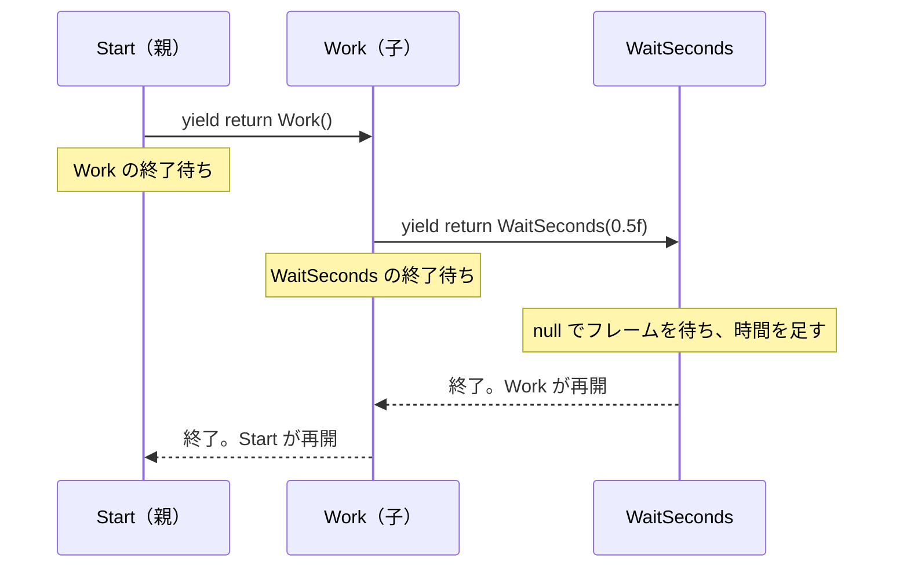

# コルーチンを組み合わせる

前のページの信号機では、色を変えるたびに `while` ループで時間の経過を待っていました。秒数を待つ処理は、メッセージを順番に表示したり、一定間隔で動作を繰り返したりするときにも使います。同じループを何度も書かずに済むよう、待機処理をメソッドにまとめましょう。

## 学習目標

- 秒数を待つループを、引数を受け取るコルーチンにまとめられる
- `yield return` に `IEnumerator` を渡すと、子の終了まで親が待つことを説明できる
- 3 段階のコルーチンが、内側から終了して再開する順序を追える

## 前提知識

- [コルーチンの基礎](/unity-csharp-learning/unity/coroutines/) を読んでいること

---

## 1. 同じ待機ループを見つける

「表示する」「少し待つ」「次を表示する」という処理を、そのまま書くと次のようになります。信号機の色の変更をログ出力に置き換えると、待機ループの重複が見えやすくなります。

空のゲームオブジェクトに、動作確認用の `SampleCoroutine` スクリプトを作成してアタッチします。

```csharp
using System.Collections;
using UnityEngine;

public class SampleCoroutine : MonoBehaviour
{
    private IEnumerator Start()
    {
        Debug.Log("A");
        float elapsed = 0f;
        while (elapsed < 0.5f)
        {
            yield return null;
            elapsed += Time.deltaTime;
        }

        Debug.Log("B");
        elapsed = 0f;
        while (elapsed < 0.5f)
        {
            yield return null;
            elapsed += Time.deltaTime;
        }

        Debug.Log("C");
    }
}
```

`A` → 約 0.5 秒後に `B` → さらに約 0.5 秒後に `C` が表示されます。`A` と `B` の後にある待機ループは、同じ形です。前のページの信号機にも、この繰り返しがありました。

待つ場所が増えるたびにループをコピーすると、時間の数え方を直したいときも、すべてのループを修正する必要があります。また、表示の順序を読みたいだけでも、途中の時間計測を何度も読み飛ばすことになります。待機の仕組みを 1 か所にまとめれば、呼び出す側には「何をして、何秒待つか」という手順が残ります。

---

## 2. 抽出したコルーチンの終了を待つ

通常のメソッドと同じように、待機ループを `WaitSeconds` に移し、待つ秒数を引数にします。ただし、このループには `yield return null` があるため、移した先も `IEnumerator` を返すコルーチンになります。

ここで必要なのは、待機を始めることだけではありません。呼び出し元も、待機が終わるまで次の表示へ進まないようにする必要があります。そのために、子のコルーチンを `yield return` で渡します。

```csharp
using System.Collections;
using UnityEngine;

public class SampleCoroutine : MonoBehaviour
{
    private IEnumerator Start()
    {
        Debug.Log("A");
        yield return WaitSeconds(0.5f);
        Debug.Log("B");
        yield return WaitSeconds(0.5f);
        Debug.Log("C");
    }

    private IEnumerator WaitSeconds(float seconds)
    {
        float elapsed = 0f;
        while (elapsed < seconds)
        {
            yield return null;
            elapsed += Time.deltaTime;
        }
    }
}
```

抽出前と同じく、`A` と `B`、`B` と `C` の間でそれぞれ約 0.5 秒待ちます。

```
A
B
C
```

`WaitSeconds` は待機ループを移したメソッドです。呼び出すたびに別の `IEnumerator` が作られ、それぞれがローカル変数 `elapsed` の値を保持します。

**`WaitSeconds(0.5f)` と呼ぶだけでは、中身は実行されません。** `IEnumerator` のオブジェクトが作られるだけです。`yield return WaitSeconds(0.5f);` とすると、そのオブジェクトが Unity に渡されます。Unity は子を進め、**子が終了するまで親の続きを進めません**。子が終了したら、親は `yield return` の次の行から再開します。

親が返しているのは秒数の計測結果ではなく、実行してもらう子の `IEnumerator` です。子が `yield return null` で中断している間は、親も待っています。

---

## 3. さらに子を待つ：3 段階の入れ子

待機を含む処理そのものも、さらに大きな手順の一部にできます。たとえば「点滅が終わったら色を変える」には、点滅の中で何回待つかを呼び出し元が知る必要はありません。点滅全体の終了を待てれば十分です。

次の例では、`Start` が一まとまりの処理 `Work` を待ち、`Work` が秒数待ちの `WaitSeconds` を待ちます。

```csharp
using System.Collections;
using UnityEngine;

public class SampleCoroutine : MonoBehaviour
{
    private IEnumerator Start()
    {
        Debug.Log("親: 開始");
        yield return Work();
        Debug.Log("親: 再開");
    }

    private IEnumerator Work()
    {
        Debug.Log("子: 開始");
        yield return WaitSeconds(0.5f);
        Debug.Log("子: 終了");
    }

    private IEnumerator WaitSeconds(float seconds)
    {
        float elapsed = 0f;
        while (elapsed < seconds)
        {
            yield return null;
            elapsed += Time.deltaTime;
        }
    }
}
```

表示は次の順です。「子: 開始」と「子: 終了」の間で約 0.5 秒待ちます。

```
親: 開始
子: 開始
子: 終了
親: 再開
```

この例は `Start` → `Work` → `WaitSeconds` の 3 段階です。



待っている親を積み重ね、内側が終了すると、その親へ戻ります。これが**コルーチンのスタック化**です。中断中も、それぞれの実行位置とローカル変数は保たれています。

通常のメソッド呼び出しのコールスタックを、フレームをまたいでそのまま保持しているという意味ではありません。Unity が `IEnumerator` を進め、待っている親を再開させています。

子を渡すこと自体が、1 フレームの待機を追加するわけではありません。この例の時間待ちは `WaitSeconds` 内の `yield return null` によるものです。子の終了後に親を再開させるためだけに、`yield return null` を加える必要もありません。

---

## 4. 実例：前のページの信号機を分割する

ここまでの仕組みを、前のページの信号機に適用します。

1. 何度も出てくる秒数待ちの `while` ループを、2 節の `WaitSeconds` にまとめる
2. 色を変えた後は、`yield return WaitSeconds(...)` でその終了を待つ
3. 点滅の `for` ループを `Blink` にまとめ、親から `yield return Blink(2)` で終了を待つ

点滅中は、`RunSignal` → `Blink` → `WaitSeconds` が、3 節と同じ入れ子になります。`CoroutineSignal` を次の全体コードに書き換えます。

### 完成したコード

```csharp
using System.Collections;
using UnityEngine;

public class CoroutineSignal : MonoBehaviour
{
    [SerializeField] private float _redDuration = 3f;
    [SerializeField] private float _blueDuration = 3f;

    private Renderer _renderer;

    private void Start()
    {
        _renderer = GetComponent<Renderer>();
        StartCoroutine(RunSignal());
    }

    private IEnumerator RunSignal()
    {
        while (true)
        {
            SetColor(Color.red, "赤");
            yield return WaitSeconds(_redDuration);

            SetColor(Color.blue, "青");
            yield return WaitSeconds(_blueDuration - 1f);

            yield return Blink(2);
        }
    }

    private IEnumerator Blink(int count)
    {
        Debug.Log("Blink 開始");
        for (int i = 0; i < count; i++)
        {
            SetColor(Color.gray, "灰");
            yield return WaitSeconds(0.25f);

            SetColor(Color.blue, "青");
            yield return WaitSeconds(0.25f);
        }
        Debug.Log("Blink 終了");
    }

    private IEnumerator WaitSeconds(float seconds)
    {
        float elapsed = 0f;
        while (elapsed < seconds)
        {
            yield return null;
            elapsed += Time.deltaTime;
        }
    }

    private void SetColor(Color color, string label)
    {
        _renderer.material.color = color;
        Debug.Log($"{Time.time:F2} 秒: {label}");
    }
}
```

`RunSignal` には「赤にして待つ → 青にして待つ → 点滅する」という全体の流れが残ります。`Blink` は点滅の手順、`WaitSeconds` は時間を数える手順を担当します。

---

## 動作確認

1. `Signal` に付けた `CoroutineSignal` を「完成したコード」に書き換える
2. Play ボタンを押す
3. 赤 → 青 → 灰 → 青 → 灰 → 青 → 赤という順序を確認する
4. Console で、`Blink 開始` が最初の灰の前に、`Blink 終了` が次の赤の前に出ることを確認する

実行結果の例です。秒数はフレームレートによって変わります。

```
0.00 秒: 赤
3.02 秒: 青
Blink 開始
5.04 秒: 灰
5.30 秒: 青
5.56 秒: 灰
5.82 秒: 青
Blink 終了
6.08 秒: 赤
```

`Blink 終了` の前に次の赤が出た場合は、`RunSignal` の呼び出しに `yield return` が付いているか確認してください。

---

## まとめ

- 待機ループも、`IEnumerator` を返すメソッドに抽出できる
- 親が `yield return` で子の `IEnumerator` を Unity に渡すと、親は子の終了まで待つ
- 子からさらに子を待てる。内側が終了すると、待っていた親が順に再開する
- 呼び出すだけでは、イテレーターの中身は実行されない

---

## 理解度チェック

1. `WaitSeconds` を呼ぶ場所ごとに、`elapsed` のフィールドを用意する必要がないのはなぜですか？
2. `WaitSeconds` が中断している間、`Blink` と `RunSignal` はどこで待っていますか？
3. `Blink 終了` と次の「赤」は、どちらが先に表示されますか？

<details markdown="1">
<summary>解答を見る</summary>

1. 呼び出すたびに作られる `IEnumerator` が、自分のローカル変数 `elapsed` の値を中断中も保持するためです。
2. `Blink` は `yield return WaitSeconds(...)`、`RunSignal` は `yield return Blink(2)` で子の終了を待っています。
3. `Blink 終了` が先です。`Blink` が終わってから `RunSignal` が再開し、ループの先頭で赤にします。

</details>

---

## 次のステップ

[コルーチンの待機方法](/unity-csharp-learning/unity/coroutine-waits/) では、自作した秒数待ちを `WaitForSeconds` に置き換えます。さらに、Space キーが押されるまで待つ処理をループで書いてから、`WaitUntil` を使う形へ進みます。
