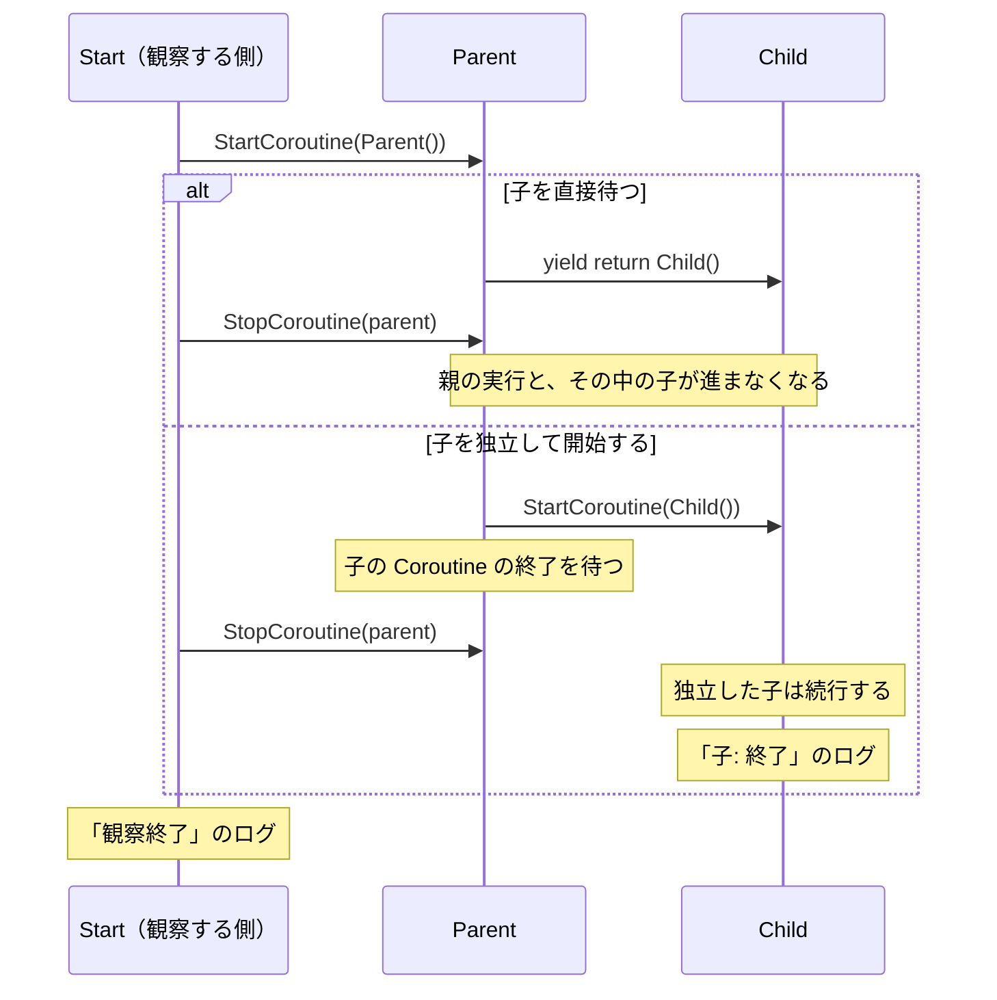

# コルーチンの開始と停止

これまでの信号機は、一度動き始めると繰り返し続けました。ゲームでは、操作を取り消したり、動作中の仕掛けの電源を切ったりすることもあります。そのときは、どのコルーチンを止めるのかを指定し、停止後の状態も整える必要があります。開始した処理の管理方法を学び、信号機の停止と再開始に使います。

## 学習目標

- `StartCoroutine` の戻り値を保存して `StopCoroutine` で止められる
- 二重の開始を防ぎ、止めた後の状態を整えられる
- 正常終了したときも実行状態を整理し、親を止めたときに子が止まる範囲を説明できる
- ゲームオブジェクトの非アクティブ化とコンポーネントの無効化の違いを説明できる

## 前提知識

- [コルーチンの待機方法](/unity-csharp-learning/unity/coroutine-waits/) の信号機を作っていること

---

## 1. 開始したコルーチンを保存して止める

同じメソッドからでも、コルーチンは何度も開始できます。そのため、メソッド名だけでは、今動いているどの処理を止めたいのかを特定できません。開始したときに、その実行を表すオブジェクトを保存しておきます。

`StartCoroutine` は、開始したコルーチンを表す [Coroutine](https://docs.unity3d.com/ScriptReference/Coroutine.html) 型のオブジェクトを返します。これを `_routine` フィールドに保存しておき、止めるときに `StopCoroutine` に渡します。

空のゲームオブジェクトに、動作確認用の `SampleCoroutine` スクリプトを作成してアタッチします。次の例は、一定間隔で数を表示する処理を P キーで停止・再開始します。

**`MonoBehaviour.StopCoroutine()`** — 動いているコルーチンを止めます。

**書式：[MonoBehaviour.StopCoroutine メソッド](https://docs.unity3d.com/ScriptReference/MonoBehaviour.StopCoroutine.html)**
```csharp
public void StopCoroutine(Coroutine routine);
```

| パラメータ | 説明 |
|---|---|
| `routine` | 止めるコルーチン。`StartCoroutine` の戻り値を渡す |

```csharp
using System.Collections;
using UnityEngine;
using UnityEngine.InputSystem;

public class SampleCoroutine : MonoBehaviour
{
    private Coroutine _routine;

    private void Start()
    {
        _routine = StartCoroutine(Work());
    }

    private void Update()
    {
        var keyboard = Keyboard.current;
        if (keyboard == null || !keyboard.pKey.wasPressedThisFrame) return;

        if (_routine != null)
        {
            StopCoroutine(_routine);
            _routine = null;
            Debug.Log("停止");
        }
        else
        {
            _routine = StartCoroutine(Work());
        }
    }

    private IEnumerator Work()
    {
        int count = 0;
        while (true)
        {
            Debug.Log($"処理: {count}");
            count++;
            yield return new WaitForSeconds(0.5f);
        }
    }
}
```

0.5 秒ごとに「処理: 0」「処理: 1」…と表示されます。Game ビューをクリックして P キーを押すと「停止」と表示され、その後は数が増えません。もう一度 P キーを押すと、「処理: 0」から新しく始まります。

`StopCoroutine` には、`StartCoroutine` で開始したものと同じ `Coroutine` を渡します。`Work()` をもう一度呼んで作った別の `IEnumerator` を渡しても、動いているものは止まりません。

止めた後の `_routine = null;` は、このコードで開始・停止を判断するための管理です。保存した参照が自動で `null` になるわけではありません。止めたコルーチンは再開せず、開始し直すと、ローカル変数の `count` も最初から作られます。

`StopCoroutine` は残りの行を実行せずに打ち切ります。途中の表示や状態を整える必要がある場合は、止めた側で行います。`try` / `finally` による後片付けにも任せられません。

### 正常終了したときも、実行状態を片付ける

ここまでの `Work` は無限ループでした。演出などの有限の処理では、外から止めなくても最後まで進んで終了します。この場合も、保存した `Coroutine` が自動で `null` になるわけではありません。参照が残ったままだと、次に開始しようとしたとき「まだ実行中」と判断してしまいます。

次の最小例では、処理の最後で `_routine` を `null` に戻します。二重の開始は断り、終了後は再び開始できます。

```csharp
using System.Collections;
using UnityEngine;

public class SampleCoroutine : MonoBehaviour
{
    private Coroutine _routine;

    private IEnumerator Start()
    {
        Begin();
        Begin();
        yield return new WaitForSeconds(1f);
        Begin();
    }

    private void Begin()
    {
        if (_routine != null)
        {
            Debug.Log("実行中なので開始しない");
            return;
        }
        _routine = StartCoroutine(Work());
    }

    private IEnumerator Work()
    {
        Debug.Log("開始");
        yield return new WaitForSeconds(0.2f);
        _routine = null;
        Debug.Log("正常終了");
    }
}
```

```
開始
実行中なので開始しない
正常終了
開始
正常終了
```

2 回目の `Begin` は実行中なので開始しません。約 0.2 秒で `Work` が終了し、最初の開始から約 1 秒後には、新しく開始できます。この例の `Work` は必ず一度待機してから終了するので、開始時に参照を保存した後で、終了時に参照を消せます。

`Work` の途中から `yield break` で正常終了する経路を増やす場合も、実行状態を戻す必要があります。一方、`StopCoroutine` による打ち切りでは最後の行へ進まないため、止めた側で状態を戻します。正常終了・停止・例外を、同じ終了経路と考えないことが大切です。

---

## 2. 開始と終了待ちを区別する

ある処理を始めた後、呼び出し元も続けて動いてほしい場合と、その処理が終わるまで待ちたい場合があります。たとえば、演出を動かしながらほかの操作を受け付ける場合は前者、演出が終わってから次の手順へ進む場合は後者です。`StartCoroutine` で開始することと、呼び出し元が終了を待つことを分けて考えます。

まず、子を開始するだけの例です。

```csharp
using System.Collections;
using UnityEngine;

public class SampleCoroutine : MonoBehaviour
{
    private IEnumerator Start()
    {
        Debug.Log("親: 開始");
        StartCoroutine(Child());
        Debug.Log("親: 続行");
        yield break;
    }

    private IEnumerator Child()
    {
        Debug.Log("子: 開始");
        yield return new WaitForSeconds(0.5f);
        Debug.Log("子: 終了");
    }
}
```

表示は次の順です。子が待っている間に、親は先へ進みます。

```
親: 開始
子: 開始
親: 続行
子: 終了
```

次に、開始した子の `Coroutine` を `yield return` で渡して終了を待ちます。

```csharp
using System.Collections;
using UnityEngine;

public class SampleCoroutine : MonoBehaviour
{
    private IEnumerator Start()
    {
        Debug.Log("親: 開始");
        yield return StartCoroutine(Child());
        Debug.Log("親: 続行");
        yield break;
    }

    private IEnumerator Child()
    {
        Debug.Log("子: 開始");
        yield return new WaitForSeconds(0.5f);
        Debug.Log("子: 終了");
    }
}
```

```
親: 開始
子: 開始
子: 終了
親: 続行
```

`StartCoroutine` は子が最初に中断するところまで実行してから戻るため、どちらも「子: 開始」が先に出ます。違うのは、親が子の終了まで待つかどうかです。

| 書き方 | 呼び出し元の進み方 |
|---|---|
| `StartCoroutine(Child());` | 子を開始し、終了を待たずに次の行へ進む |
| `yield return Child();` | 子の `IEnumerator` を渡し、終了まで待つ。前のページまでと同じ仕組み |
| `yield return StartCoroutine(Child());` | 開始時に返された `Coroutine` を使って、子の終了を待つ |

### 親を止めたら、子も止まるのか

終了を待っていることと、その処理を一緒に停止できることも別です。`yield return Child()` は親の実行の一部として子を進めます。一方、`StartCoroutine(Child())` は子を独立したコルーチンとして開始します。その戻り値を待っている親を止めても、独立して開始済みの子は止まりません。

次の例では、親を約 0.1 秒後に止め、子が約 0.3 秒後の「子: 終了」へ到達するかを比べます。Inspector の **Start Child Separately** がオフなら直接子を待ち、オンなら独立して開始した子を待ちます。

```csharp
using System.Collections;
using UnityEngine;

public class SampleCoroutine : MonoBehaviour
{
    [SerializeField] private bool _startChildSeparately;

    private IEnumerator Start()
    {
        Coroutine parent = StartCoroutine(Parent());
        yield return new WaitForSeconds(0.1f);
        StopCoroutine(parent);
        Debug.Log("親を停止");
        yield return new WaitForSeconds(0.4f);
        Debug.Log("観察終了");
    }

    private IEnumerator Parent()
    {
        Debug.Log("親: 開始");
        if (_startChildSeparately)
        {
            yield return StartCoroutine(Child());
        }
        else
        {
            yield return Child();
        }
        Debug.Log("親: 再開");
    }

    private IEnumerator Child()
    {
        Debug.Log("子: 開始");
        yield return new WaitForSeconds(0.3f);
        Debug.Log("子: 終了");
    }
}
```

オフの場合は、子も先へ進まなくなります。

```
親: 開始
子: 開始
親を停止
観察終了
```

オンの場合は、親を止めた後に子が終了します。「親: 再開」はどちらにも出ません。

```
親: 開始
子: 開始
親を停止
子: 終了
観察終了
```

独立して開始した子も一緒に止めたい場合は、子の `Coroutine` も保存し、明示的に停止します。親を止めることだけで、開始済みの処理全体を取り消せるとは限りません。



---

## 3. ゲームオブジェクトとの関係を知る

コルーチンは、`StopCoroutine` を呼んだときのほかにも止まることがあります。コルーチンは、`StartCoroutine` を呼んだスクリプトのゲームオブジェクトに結び付いていて、ゲームオブジェクトの状態によって止まるかどうかが決まります。

| 操作 | コルーチン |
|---|---|
| `StopCoroutine` / `StopAllCoroutines` を呼ぶ | 止まる |
| ゲームオブジェクトを非アクティブにする（`SetActive(false)`） | 止まる。アクティブに戻しても再開しない |
| ゲームオブジェクトやスクリプトを破棄する（`Destroy`） | 止まる |
| スクリプトのコンポーネントを無効にする（`enabled = false`） | **止まらない** |

1 節の短い例でも確認できます。コンポーネントのチェックを外しても数は増え続けますが、`Update` が止まるため P キーには反応しません。ゲームオブジェクトを非アクティブにすると数の表示も止まり、アクティブに戻しても再開しません。

同じコンポーネントで開始したコルーチンをまとめて止める場合は [MonoBehaviour.StopAllCoroutines](https://docs.unity3d.com/ScriptReference/MonoBehaviour.StopAllCoroutines.html) を使います。

`StopAllCoroutines` の範囲は、その `MonoBehaviour` で開始したコルーチンです。同じゲームオブジェクト上でも別のコンポーネントで開始したものや、シーン内のコルーチン全体を止める操作ではありません。

非アクティブ化による停止でも、保存した参照や自分で持つ「実行中」の状態は自動で初期化されません。オブジェクトを再利用するときは、非アクティブ化する側や `OnDisable` で状態を整理し、必要に応じて `OnEnable` から新しく開始する設計にします。

---

## 4. 実例：信号機に停止と再開始を加える

前のページの信号機に適用します。開始時の `Coroutine` を `_signalRoutine` に保存し、P キーから呼ぶ `TogglePower` で停止・再開始を切り替えます。

停止後は球体を黒にして、途中の点滅の色が残らないようにします。再開始するときは、停止中の Space キーによる要求を取り消し、赤から始めます。`RunSignal` 内の点滅は、これまでどおり `yield return Blink(2);` で終了まで待ちます。

### 完成したコード

```csharp
using System.Collections;
using UnityEngine;
using UnityEngine.InputSystem;

public class CoroutineSignal : MonoBehaviour
{
    private Renderer _renderer;
    private bool _isRequested;
    private Coroutine _signalRoutine; // 追加：動いているコルーチン

    private void Start()
    {
        _renderer = GetComponent<Renderer>();
        _signalRoutine = StartCoroutine(RunSignal()); // 変更：戻り値を保存する
    }

    private void Update()
    {
        var keyboard = Keyboard.current;
        if (keyboard == null) return;

        if (keyboard.spaceKey.wasPressedThisFrame)
        {
            RequestGreen();
        }

        if (keyboard.pKey.wasPressedThisFrame)
        {
            TogglePower();
        }
    }

    public void RequestGreen()
    {
        Debug.Log($"{Time.time:F2} 秒: 切り替え要求");
        _isRequested = true;
    }

    // 追加：P キーの入力から呼ばれる
    public void TogglePower()
    {
        if (_signalRoutine != null)
        {
            StopCoroutine(_signalRoutine);
            _signalRoutine = null;
            SetColor(Color.black, "消灯");
        }
        else
        {
            _isRequested = false;
            _signalRoutine = StartCoroutine(RunSignal());
        }
    }

    private IEnumerator RunSignal()
    {
        while (true)
        {
            SetColor(Color.red, "赤");
            yield return new WaitUntil(() => _isRequested);
            _isRequested = false;

            yield return new WaitForSeconds(1f);

            SetColor(Color.blue, "青");
            yield return new WaitForSeconds(2f);

            yield return Blink(2);
        }
    }

    private IEnumerator Blink(int count)
    {
        for (int i = 0; i < count; i++)
        {
            SetColor(Color.gray, "灰");
            yield return new WaitForSeconds(0.25f);

            SetColor(Color.blue, "青");
            yield return new WaitForSeconds(0.25f);
        }
    }

    private void SetColor(Color color, string label)
    {
        _renderer.material.color = color;
        Debug.Log($"{Time.time:F2} 秒: {label}");
    }
}
```

点滅の途中で親の `RunSignal` を止めると、その中で待っていた点滅も続かなくなります。止めた側で黒にするため、灰色や青のまま残りません。

---

## 動作確認

1. 前のページと同じシーンを開く
2. `CoroutineSignal` スクリプトを 4 節の「完成したコード」に書き換える
3. Play ボタンを押し、Game ビューをクリックする

次の操作をして、球体の色と Console の表示を確認してください。

1. 何もしない間、球体は赤のまま変わらない
2. Space キーを押すと、約 1 秒後に青になる
3. 青になってから約 2 秒後に点滅が始まる。点滅している間に P キーを押すと、球体が黒になる
4. 黒の間に Space キーを押してから、P キーを押すと、球体は赤になり、切り替え要求を待つ（黒の間の切り替え要求は取り消される）
5. Space キーを押すと、約 1 秒後に青になる

Console には次のように表示されます。これは実行結果の例です。秒数は、キーを押した時刻とフレームレートによって変わります。

```
0.00 秒: 赤
1.00 秒: 切り替え要求
2.04 秒: 青
4.06 秒: 灰
4.32 秒: 青
4.40 秒: 消灯
4.90 秒: 切り替え要求
5.40 秒: 赤
6.40 秒: 切り替え要求
7.44 秒: 青
```

---

## よくあるミス

### 動いているかを確かめずに、もう一度開始する

`StartCoroutine` は、呼ぶたびに新しいコルーチンを開始します。動いているコルーチンを止めずに、もう一度 `StartCoroutine` を呼ぶと、同じコルーチンが 2 つ同時に動きます。

```csharp
public void TogglePower()
{
    // ❌ NG: 動いているかどうかを確かめずに開始する
    _signalRoutine = StartCoroutine(RunSignal());
}
```

4 節の `TogglePower` をこのように書き換えて、P キーを 1 回押してから、Space キーを 2 回続けて押すと、2 つの `RunSignal` がずれて動き、色の変わり方が乱れます。

```
0.00 秒: 赤
1.00 秒: 赤
2.00 秒: 切り替え要求
2.50 秒: 切り替え要求
3.04 秒: 青
3.54 秒: 青
5.06 秒: 灰
5.32 秒: 青
5.56 秒: 灰
5.58 秒: 灰
5.82 秒: 青
5.84 秒: 青
6.08 秒: 灰
6.10 秒: 赤
6.34 秒: 青
6.60 秒: 赤
```

6.10 秒に赤になった直後に、もう 1 つの `RunSignal` が点滅を続けて、6.34 秒に青にしています。また、`_signalRoutine` には後から開始したコルーチンしか残らないので、最初に開始したコルーチンは `StopCoroutine` で止められなくなります。

コルーチンを開始する前に、4 節のように `Coroutine` のフィールドが `null` かどうかを確かめます。

### StopCoroutine にメソッドの呼び出しを渡す

`StopCoroutine` には、`IEnumerator` を受け取るオーバーロードもあります。そのため、次のように書いてもコンパイルエラーにはなりません。

```csharp
// ❌ NG: 新しい IEnumerator を作って渡しているので、動いているコルーチンは止まらない
StopCoroutine(RunSignal());

// ✅ OK: StartCoroutine の戻り値を渡す
StopCoroutine(_signalRoutine);
```

`RunSignal()` を呼ぶと、そのたびに新しい `IEnumerator` が作られます。`StartCoroutine` に渡したものとは別のオブジェクトなので、動いているコルーチンは止まりません。エラーも警告も表示されないので、気付きにくいミスです。

---

## まとめ

- `StartCoroutine` の戻り値を保存し、同じ `Coroutine` を `StopCoroutine` に渡して止める
- 止めたコルーチンは再開しない。開始し直すと最初から動く
- 二重の開始を防ぎ、停止時の後片付けは止めた側で行う
- 有限の処理は正常終了時も実行状態を整理する。独立して開始した子は、親を止めるだけでは止まらない
- ゲームオブジェクトを非アクティブにすると止まるが、コンポーネントを無効にしてもコルーチンは止まらない（`Update` による入力受付は止まる）
- コルーチンの開始と、呼び出し元が終了を待つことは別の操作である

---

## 理解度チェック

1. 停止後に `_signalRoutine = null;` とするのはなぜですか？
2. ゲームオブジェクトを非アクティブにしてから、アクティブに戻すと、コルーチンは再開しますか？
3. `StartCoroutine(Blink(2));` と `yield return Blink(2);` では、次の行へ進むタイミングがどう違いますか？

<details markdown="1">
<summary>解答を見る</summary>

1. この例では、フィールドが `null` かどうかを開始・停止の判断に使っているためです。保存した `Coroutine` が、停止時に自動で `null` になるわけではありません。
2. 再開しません。必要なら改めて開始します。
3. 前者は子の終了を待ちません。後者は子が終了するまで親が待ち、終了後に次の行へ進みます。

</details>

---

## 次のステップ

[コルーチンでは書きにくいこと](/unity-csharp-learning/unity/coroutine-limits/) では、Space キーで青への切り替えを要求する信号機に機能を加えながら、コルーチンでは結果を返したり失敗を `try` / `catch` で受け取ったりできないことを確かめ、C# の `Task` と `async` / `await` との対応を整理します。
