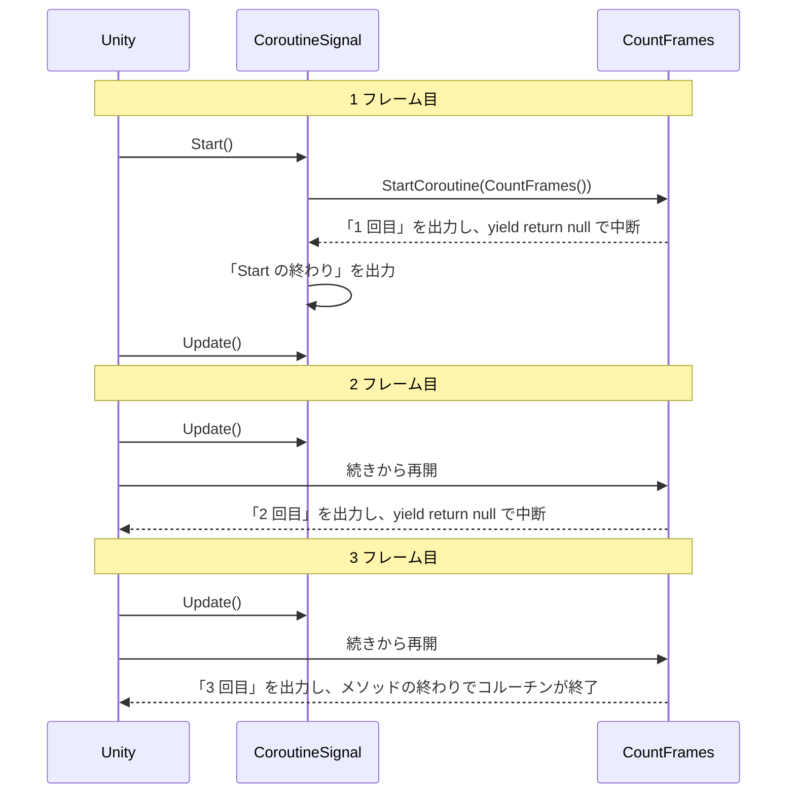
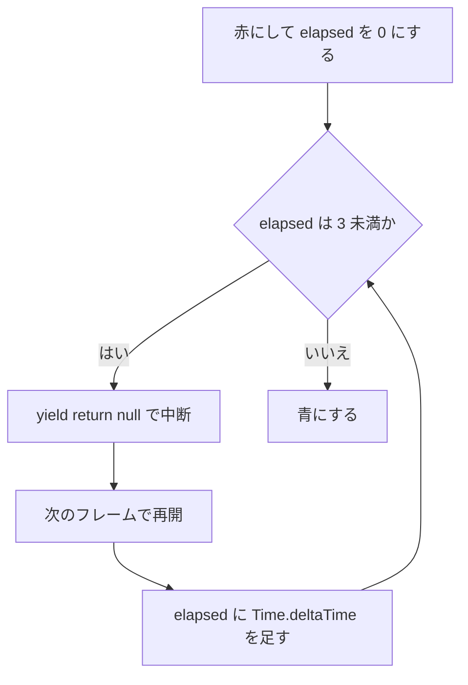

# コルーチンの基礎

**コルーチン**（coroutine）は、途中で中断して、次のフレームや指定した秒数の後に続きから再開できる処理です。`Update` で書くと状態やタイマーのフィールドが必要になる「赤を 3 秒 → 青を 2 秒 → 点滅を 1 秒」のような順番のある処理を、上から下へ順に書けます。このページでは、[チュートリアル: 信号機](/unity-csharp-learning/unity/traffic-light/) の点滅する信号機を、コルーチンで書き直します。

コルーチンのコードは、`Update` などと同じメインスレッドで実行されます。待機中は Unity に制御を戻すことでほかの処理を進められるのであり、計算を別スレッドへ移す機能ではありません。実行するスレッドの違いは、後の[補足：Unity のメインスレッドと別スレッド](/unity-csharp-learning/unity/main-thread/)で確かめます。

## 学習目標

このページを読み終えると、以下のことができるようになります。

- `Update` だけで順番のある処理を書くと、状態やタイマーのフィールドが増える理由を説明できる
- `IEnumerator` を返すメソッドを書き、`StartCoroutine` でコルーチンとして開始できる
- `yield return null` で次のフレームまで待てる
- `Time.deltaTime` をローカル変数に足しながら、指定した秒数だけ待てる
- コルーチンが `Start` や `Update` に対してどの順序で実行されるかを説明できる

## 前提知識

- [Update メソッドと連続実行](/unity-csharp-learning/unity/update-basics/) を読んでいること
- [Time クラスと時間制御](/unity-csharp-learning/unity/time-basics/) を読んでいること
- [チュートリアル: 信号機](/unity-csharp-learning/unity/traffic-light/) の課題 3 まで読んでいること
- [イテレーターと yield return](/unity-csharp-learning/csharp/iterators/) を読んでいると、コルーチンの仕組みを理解しやすくなります

---

## 1. Update で書いた点滅を振り返る

[チュートリアル: 信号機](/unity-csharp-learning/unity/traffic-light/) の課題 3 では、赤と青を 3 秒ずつ切り替え、青の残り 1 秒で点滅させました。解答のスクリプトは次のとおりです。

<details markdown="1">
<summary>Update 版の全体コードを振り返る</summary>

```csharp
using UnityEngine;

public class Signal : MonoBehaviour
{
    private int _state = 0;
    private float _timer = 0f;
    private float _redDuration = 3f;
    private float _blueDuration = 3f;
    private float _blinkTimer = 0f;
    private bool _isBlinkOn = true;
    private Renderer _renderer;

    private void Start()
    {
        _renderer = GetComponent<Renderer>();
        TransitionTo(_state);
    }

    private void Update()
    {
        _timer += Time.deltaTime;

        switch (_state)
        {
            case 0:  UpdateRed();  break;
            case 1: UpdateBlue(); break;
        }
    }

    private void UpdateRed()
    {
        if (_timer >= _redDuration)
            TransitionTo(1); // 青に遷移
    }

    private void UpdateBlue()
    {
        // 残り 1 秒で点滅
        if (_timer >= _blueDuration - 1f)
        {
            _blinkTimer += Time.deltaTime;
            if (_blinkTimer >= 0.25f)
            {
                _blinkTimer -= 0.25f;
                _isBlinkOn = !_isBlinkOn;
                _renderer.material.color = _isBlinkOn ? Color.blue : Color.gray;
            }
        }

        if (_timer >= _blueDuration)
            TransitionTo(0); // 赤に遷移
    }

    private void TransitionTo(int next) // 状態遷移（リセット）
    {
        _timer = 0f;
        _blinkTimer = 0f;
        _isBlinkOn = true;
        _state = next;
        _renderer.material.color = next == 0 ? Color.red : Color.blue;
    }
}
```

</details>

このスクリプトは正しく動きます。しかし、やりたいことは「赤を 3 秒 → 青を 2 秒 → 点滅を 1 秒 → 最初に戻る」という順番だけなのに、コードからはその順番が読み取りにくくなっています。

`Update` は毎フレーム最初から呼ばれ、前のフレームでどこまで進んだかを覚えていません。そのため、進み具合をすべてフィールドに保存しておく必要があります。

| フィールド | 覚えておくこと |
|---|---|
| `_state` | 今、赤と青のどちらの段階にいるか |
| `_timer` | その段階に入ってから何秒たったか |
| `_blinkTimer` | 点滅の切り替えから何秒たったか |
| `_isBlinkOn` | 点滅の今の色が青か灰色か |

段階が変わるたびに、これらを `TransitionTo` でリセットする必要もあります。黄色の段階を加えたり、点滅の回数を変えたりするたびに、フィールドと `if` が増えていきます。

コルーチンを使うと、「どこまで進んだか」をフィールドではなく、**メソッドの中で実行している位置**として Unity に覚えておいてもらえます。

---

## 2. シーンを準備する

1. メニューバーの **File → New Scene** で新しいシーンを作成する
2. **GameObject → 3D Object → Sphere** で球体を追加し、名前を `Signal` に変更する
3. `Signal` を選択し、Inspector ビューの **Add Component → New script** から `CoroutineSignal` という名前のスクリプトを作成してアタッチする

球体の位置は、作成されたときの (0, 0, 0) のままでかまいません。このページでは、`CoroutineSignal` スクリプトを書き換えながら進めます。

---

## 3. コルーチンを書いて開始する

`CoroutineSignal` スクリプトを次のように書き換えます。

```csharp
using System.Collections;
using UnityEngine;

public class CoroutineSignal : MonoBehaviour
{
    private void Start()
    {
        StartCoroutine(CountFrames());
    }

    private IEnumerator CountFrames()
    {
        Debug.Log($"{Time.frameCount} フレーム目: 1 回目");
        yield return null;

        Debug.Log($"{Time.frameCount} フレーム目: 2 回目");
        yield return null;

        Debug.Log($"{Time.frameCount} フレーム目: 3 回目");
    }
}
```

Play ボタンを押すと、Console に次のように表示されます。`Time.frameCount` は、ゲームを開始してから何フレーム目かを表すプロパティです。

```
1 フレーム目: 1 回目
2 フレーム目: 2 回目
3 フレーム目: 3 回目
```

3 つの `Debug.Log` が、1 フレームに 1 つずつ実行されました。

### コルーチンにするメソッド

コルーチンにするメソッドは、戻り値の型を `IEnumerator` にして、中に `yield return` を書きます。`IEnumerator` は `System.Collections` 名前空間にあるので、`using System.Collections;` を追加します。

`yield return` は、そこでメソッドの実行を中断する文です。`yield return null;` と書くと、コルーチンは**次のフレームまで**中断し、次のフレームで `yield return` の次の行から再開します。

`yield return` を含むメソッドは、C# では**イテレーター**と呼ばれます。呼び出すと、実行位置やローカル変数を保持しながら処理を進められるオブジェクトを返します（詳しくは [イテレーターと yield return](/unity-csharp-learning/csharp/iterators/) を参照）。Unity は、このしくみを使って、コルーチンをフレームごとに少しずつ進めます。

### StartCoroutine でコルーチンを開始する

**`MonoBehaviour.StartCoroutine()`** — `IEnumerator` を返すメソッドを、コルーチンとして開始します。

**書式：[MonoBehaviour.StartCoroutine メソッド](https://docs.unity3d.com/ScriptReference/MonoBehaviour.StartCoroutine.html)**
```csharp
public Coroutine StartCoroutine(IEnumerator routine);
```

| パラメータ | 説明 |
|---|---|
| `routine` | コルーチンとして実行する `IEnumerator`。コルーチンにするメソッドを呼び出した結果を渡す |

`StartCoroutine(CountFrames())` は、`CountFrames()` を呼び出して得た `IEnumerator` を Unity に渡します。Unity はそれを預かり、`yield return` で中断するたびに、再開するタイミングを見計らって続きを実行します。

> 💡 **ポイント**: `yield return` で中断するのは、そのコルーチンだけです。ゲーム全体が止まるわけではありません。コルーチンが中断している間も、`Update` やほかのスクリプトは通常どおり実行されます。

---

## 4. コルーチンが実行される順序

コルーチンが `Start` や `Update` に対していつ実行されるのかを確かめます。`CoroutineSignal` スクリプトを次のように書き換えます。`Start` の始めと終わり、`Update` にも `Debug.Log` を追加しています。

```csharp
using System.Collections;
using UnityEngine;

public class CoroutineSignal : MonoBehaviour
{
    private void Start()
    {
        Debug.Log($"{Time.frameCount} フレーム目: Start の始め");
        StartCoroutine(CountFrames());
        Debug.Log($"{Time.frameCount} フレーム目: Start の終わり");
    }

    private void Update()
    {
        if (Time.frameCount <= 3)
        {
            Debug.Log($"{Time.frameCount} フレーム目: Update");
        }
    }

    private IEnumerator CountFrames()
    {
        Debug.Log($"{Time.frameCount} フレーム目: 1 回目");
        yield return null;

        Debug.Log($"{Time.frameCount} フレーム目: 2 回目");
        yield return null;

        Debug.Log($"{Time.frameCount} フレーム目: 3 回目");
    }
}
```

`Update` の `Debug.Log` は、Console が埋まらないように 3 フレーム目までに限っています。Play ボタンを押すと、Console に次のように表示されます。

```
1 フレーム目: Start の始め
1 フレーム目: 1 回目
1 フレーム目: Start の終わり
1 フレーム目: Update
2 フレーム目: Update
2 フレーム目: 2 回目
3 フレーム目: Update
3 フレーム目: 3 回目
```

この出力から、2 つのことがわかります。

- **`StartCoroutine` を呼んだ時点で、最初の `yield return` までが実行される。** 「1 回目」は「Start の終わり」より前に表示されています。`StartCoroutine` は、コルーチンを最初の `yield return` まで実行してから戻ります。
- **`yield return null` で中断したコルーチンは、次のフレームの `Update` の後で再開する。** 2 フレーム目と 3 フレーム目では、「Update」の後に、コルーチンの続きが表示されています。

順序を図にすると、次のようになります。



---

## 5. コルーチンの中で秒数を数える

次に、球体を赤にして、約 3 秒後に青へ変えます。使うのは、ここまでに学んだ `while`、`Time.deltaTime`、`yield return null` です。`CoroutineSignal` スクリプトを次のように書き換えます。

```csharp
using System.Collections;
using UnityEngine;

public class CoroutineSignal : MonoBehaviour
{
    private Renderer _renderer;

    private void Start()
    {
        _renderer = GetComponent<Renderer>();
        StartCoroutine(ChangeColor());
    }

    private IEnumerator ChangeColor()
    {
        SetColor(Color.red, "赤");
        float elapsed = 0f;
        while (elapsed < 3f)
        {
            yield return null;
            elapsed += Time.deltaTime;
        }
        SetColor(Color.blue, "青");
    }

    private void SetColor(Color color, string label)
    {
        _renderer.material.color = color;
        Debug.Log($"{Time.time:F2} 秒: {label}");
    }
}
```

`SetColor` は、球体の色を変え、そのときの `Time.time` と色の名前を Console に表示するメソッドです。

`elapsed` は、この待機を始めてからの経過時間です。`yield return null` で次のフレームまで中断し、再開したら `Time.deltaTime` を足します。これを、合計が 3 秒以上になるまで繰り返します。先に次のフレームを待ってから時間を足すため、待機を始める前のフレームの時間を数えずに済みます。

`Update` と違い、ループの途中で中断しても、ローカル変数 `elapsed` の値は保たれます。`while` の条件を満たさなくなったら、ループを抜けて青にします。待機中も、ほかのスクリプトや画面の描画は進みます。



Play ボタンを押すと、赤から約 3 秒後に青へ変わります。Console の実行結果の例です。秒数はフレームレートによって変わります。

```
0.00 秒: 赤
3.02 秒: 青
```

再開はフレーム単位なので、3.00 秒ちょうどに色が変わるとは限りません。`Time.deltaTime` はゲーム時間なので、`Time.timeScale` の影響も受けます。

---

## 6. 信号機をコルーチンで書き直す

`yield return null` と `Time.deltaTime` を使って、1 節の点滅する信号機を書き直します。`CoroutineSignal` スクリプトを次のように書き換えます。

```csharp
using System.Collections;
using UnityEngine;

public class CoroutineSignal : MonoBehaviour
{
    [SerializeField] private float _redDuration = 3f;
    [SerializeField] private float _blueDuration = 3f;

    private Renderer _renderer;

    private void Start()
    {
        _renderer = GetComponent<Renderer>();
        StartCoroutine(RunSignal());
    }

    private IEnumerator RunSignal()
    {
        float elapsed;

        while (true)
        {
            SetColor(Color.red, "赤");
            elapsed = 0f;
            while (elapsed < _redDuration)
            {
                yield return null;
                elapsed += Time.deltaTime;
            }

            SetColor(Color.blue, "青");
            elapsed = 0f;
            while (elapsed < _blueDuration - 1f)
            {
                yield return null;
                elapsed += Time.deltaTime;
            }

            // 青の残り 1 秒で、0.25 秒ごとに灰色と青を切り替える
            for (int i = 0; i < 2; i++)
            {
                SetColor(Color.gray, "灰");
                elapsed = 0f;
                while (elapsed < 0.25f)
                {
                    yield return null;
                    elapsed += Time.deltaTime;
                }

                SetColor(Color.blue, "青");
                elapsed = 0f;
                while (elapsed < 0.25f)
                {
                    yield return null;
                    elapsed += Time.deltaTime;
                }
            }
        }
    }

    private void SetColor(Color color, string label)
    {
        _renderer.material.color = color;
        Debug.Log($"{Time.time:F2} 秒: {label}");
    }
}
```

`RunSignal` を上から読むと、「赤にして 3 秒待つ → 青にして 2 秒待つ → 灰色と青を 0.25 秒ずつ 2 回繰り返す → 最初に戻る」という順番が、そのまま書かれています。

`while (true)` は終わらないループですが、ループの中に `yield return` があるので、ゲームは止まりません。`yield return` のたびにコルーチンが中断し、Unity はその間にほかの処理やフレームの描画を進めます。

1 節の `Update` 版で使っていたフィールドは、次のものに置き換わりました。

| `Update` 版 | コルーチン版 |
|---|---|
| `_state`（どの段階か） | `RunSignal` の中で、今実行している位置 |
| `_timer`（段階に入ってからの秒数） | ローカル変数 `elapsed` |
| `_blinkTimer`、`_isBlinkOn`（点滅の状態） | `for` 文の `i` と、順に並べた 2 つの `SetColor` |
| `TransitionTo` でのリセット | 不要。次の段階は次の行に書く |

`elapsed` と `for` 文の変数 `i` は、フィールドではなくローカル変数です。コルーチンが中断している間も、ローカル変数の値は保たれます。

---

赤、青、灰色を表示するたびに、同じ形の待機ループが出てきました。このページではそのまま動かし、次のページで共通のメソッドへまとめます。

## 動作確認

1. 2 節で準備したシーンの `Signal` を使い、`CoroutineSignal` を 6 節のコードに書き換える
2. Play ボタンを押す

Game ビューで、球体が次の順に色を変え、これを繰り返すことを確認してください。

1. 赤（3 秒）
2. 青（2 秒）
3. 灰色と青を 0.25 秒ずつ交互に 2 回（1 秒）

Console には次のように表示されます。これは実行結果の例です。秒数の小数部分は、フレームレートによって変わります。コルーチンの再開はフレーム単位なので、繰り返すうちに少しずつ遅れていきます。

```
0.00 秒: 赤
3.02 秒: 青
5.04 秒: 灰
5.30 秒: 青
5.56 秒: 灰
5.82 秒: 青
6.08 秒: 赤
```

---

## よくあるミス

### コルーチンのメソッドを呼び出すだけで終える

コルーチンにするメソッドを、普通のメソッドのように呼び出しても、何も実行されません。

```csharp
// ❌ NG: IEnumerator が作られるだけで、Console に何も表示されない
CountFrames();

// ✅ OK: Unity にコルーチンとして渡す
StartCoroutine(CountFrames());
```

`yield return` を含むメソッドは、呼び出しても中身を実行せず、`IEnumerator` のオブジェクトを返すだけです。中身を実行するのは、`IEnumerator` の `MoveNext` メソッドが呼ばれたときです。`StartCoroutine` に渡すと、Unity が `MoveNext` を呼んで進めてくれます。

### yield return のないループを書く

`while (true)` のループの中で `yield return` を通らないと、コルーチンは中断しません。ループが同じフレームの中で回り続け、Unity Editor が応答しなくなります。

```csharp
// ❌ NG: yield return がないので、ループが終わらず Unity Editor が固まる
while (true)
{
    SetColor(Color.red, "赤");
    SetColor(Color.blue, "青");
}
```

ループで時間をかけたい処理には、ループの中に必ず `yield return` を書きます。`if` の中だけに `yield return` を書いた場合も、条件を満たさない間は同じことが起きます。

### Update の中で StartCoroutine を呼ぶ

`StartCoroutine` は、呼ぶたびに新しいコルーチンを開始します。`Update` の中で呼ぶと、毎フレーム新しいコルーチンが増えていきます。

```csharp
using System.Collections;
using UnityEngine;

public class CoroutineSignal : MonoBehaviour
{
    private void Update()
    {
        // ❌ NG: 毎フレーム、新しいコルーチンを開始してしまう
        StartCoroutine(CountFrames());
    }

    private IEnumerator CountFrames()
    {
        Debug.Log($"{Time.frameCount} フレーム目: 1 回目");
        yield return null;

        Debug.Log($"{Time.frameCount} フレーム目: 2 回目");
        yield return null;

        Debug.Log($"{Time.frameCount} フレーム目: 3 回目");
    }
}
```

Console には、1 フレームに複数の行が表示されます。3 フレーム目以降は、3 つのコルーチンが同時に進んでいます。

```
1 フレーム目: 1 回目
2 フレーム目: 1 回目
2 フレーム目: 2 回目
3 フレーム目: 1 回目
3 フレーム目: 2 回目
3 フレーム目: 3 回目
```

コルーチンは、`Start` や、ボタンが押されたときなど、開始したいときに 1 回だけ `StartCoroutine` を呼びます。

---

## ワンポイントアドバイス

### Start メソッドをコルーチンにする

`Start` メソッドは、戻り値の型を `IEnumerator` にすると、それ自体がコルーチンになります。`StartCoroutine` を呼ばなくても、Unity がコルーチンとして開始します。

```csharp
using System.Collections;
using UnityEngine;

public class CoroutineSignal : MonoBehaviour
{
    private IEnumerator Start()
    {
        Debug.Log($"{Time.time:F2} 秒: Start の始め");
        float elapsed;
        elapsed = 0f;
        while (elapsed < 1f)
        {
            yield return null;
            elapsed += Time.deltaTime;
        }

        Debug.Log($"{Time.time:F2} 秒: 1 秒後");
    }
}
```

Console には次のように表示されます。これは実行結果の例です。秒数の小数部分は、フレームレートによって変わります。

```
0.00 秒: Start の始め
1.02 秒: 1 秒後
```

ゲームの開始時に、少し待ってから何かをしたいときに便利です。

---

## まとめ

- `Update` で順番のある処理を書くと、どの段階か、何秒たったかをフィールドに保存し、段階が変わるたびにリセットする必要がある
- コルーチンは、`IEnumerator` を返し、`yield return` を含むメソッドとして書き、`StartCoroutine` で開始する
- `yield return null` で次のフレームまで中断し、再開するたびに `Time.deltaTime` を足すと、秒数を待つ処理を書ける
- `StartCoroutine` を呼ぶと最初の `yield return` まで実行され、中断したコルーチンはフレームの `Update` の後で再開する
- 中断している間も、ローカル変数の値と実行している位置は保たれる

---

## 理解度チェック

1. 1 節の `Update` 版の信号機で、`_blinkTimer` と `_isBlinkOn` のフィールドが必要だったのはなぜですか？
2. `CoroutineSignal` スクリプトを次のように書き換えて Play ボタンを押すと、Console にどの順で表示されますか？

   ```csharp
   using System.Collections;
   using UnityEngine;

   public class CoroutineSignal : MonoBehaviour
   {
       private void Start()
       {
           Debug.Log("A");
           StartCoroutine(Routine());
           Debug.Log("B");
       }

       private IEnumerator Routine()
       {
           Debug.Log("C");
           yield return null;
           Debug.Log("D");
       }
   }
   ```

3. `StartCoroutine(RunSignal());` と `RunSignal();` の違いを説明してください。
4. （応用）6 節の信号機に、青の点滅の後で黄色を 1 秒表示する段階を加えてください。黄色の秒数は Inspector から変更できるようにします。

<details markdown="1">
<summary>解答を見る</summary>

1. `Update` は毎フレーム最初から呼ばれ、前のフレームでどこまで進んだかを覚えていないためです。点滅の切り替えから何秒たったか、今の色が青か灰色かをフィールドに保存しておかないと、次のフレームで点滅を続けられません。
2. `A`、`C`、`B`、`D` の順に表示されます。`StartCoroutine` を呼んだ時点で最初の `yield return` まで実行されるので `C` が `B` より先に表示され、`D` は次のフレームで表示されます。
3. `StartCoroutine(RunSignal())` は、`RunSignal()` が返す `IEnumerator` を Unity に渡し、コルーチンとして進めてもらいます。`RunSignal()` だけでは `IEnumerator` のオブジェクトが作られるだけで、メソッドの中身は 1 行も実行されません。
4. `_yellowDuration` フィールドを追加し、`for` 文の後ろに黄色の段階を書きます。

   ```csharp
   using System.Collections;
   using UnityEngine;

   public class CoroutineSignal : MonoBehaviour
   {
       [SerializeField] private float _redDuration = 3f;
       [SerializeField] private float _blueDuration = 3f;
       [SerializeField] private float _yellowDuration = 1f;

       private Renderer _renderer;

       private void Start()
       {
           _renderer = GetComponent<Renderer>();
           StartCoroutine(RunSignal());
       }

       private IEnumerator RunSignal()
       {
           float elapsed;

           while (true)
           {
               SetColor(Color.red, "赤");
               elapsed = 0f;
               while (elapsed < _redDuration)
               {
                   yield return null;
                   elapsed += Time.deltaTime;
               }

               SetColor(Color.blue, "青");
               elapsed = 0f;
               while (elapsed < _blueDuration - 1f)
               {
                   yield return null;
                   elapsed += Time.deltaTime;
               }

               // 青の残り 1 秒で、0.25 秒ごとに灰色と青を切り替える
               for (int i = 0; i < 2; i++)
               {
                   SetColor(Color.gray, "灰");
                   elapsed = 0f;
                   while (elapsed < 0.25f)
                   {
                       yield return null;
                       elapsed += Time.deltaTime;
                   }

                   SetColor(Color.blue, "青");
                   elapsed = 0f;
                   while (elapsed < 0.25f)
                   {
                       yield return null;
                       elapsed += Time.deltaTime;
                   }
               }

               SetColor(Color.yellow, "黄");
               elapsed = 0f;
               while (elapsed < _yellowDuration)
               {
                   yield return null;
                   elapsed += Time.deltaTime;
               }
           }
       }

       private void SetColor(Color color, string label)
       {
           _renderer.material.color = color;
           Debug.Log($"{Time.time:F2} 秒: {label}");
       }
   }
   ```

   `Update` 版では、段階を表す番号と、段階ごとの秒数の選び方と色の選び方を、それぞれ変更する必要がありました。コルーチン版では、段階を加える位置に、色を変える処理と待機ループを書き足します。

</details>

---

## 次のステップ

信号機は動きましたが、秒数を数える同じ `while` ループを何度も書いています。[コルーチンを組み合わせる](/unity-csharp-learning/unity/coroutine-composition/) では、この待機処理をメソッドにまとめ、別のコルーチンの終了を待つ方法を学びます。

`IEnumerator` と `yield return` 自体の仕組みを詳しく知りたいときは、[補足: IEnumerator と yield return](/unity-csharp-learning/unity/ienumerator-yield/) を参照してください。
