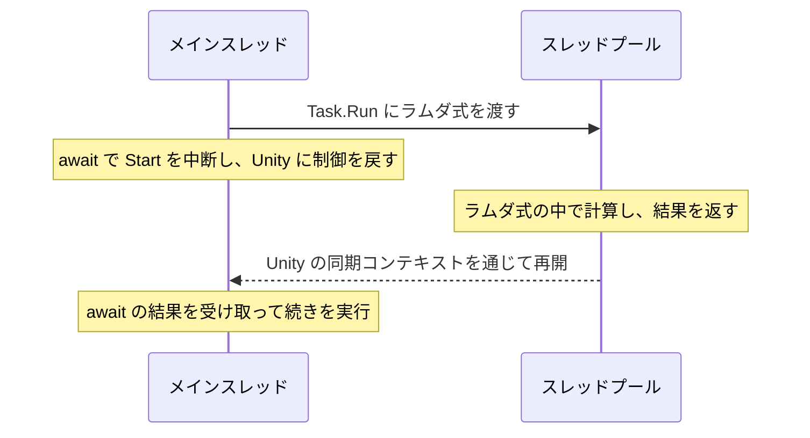
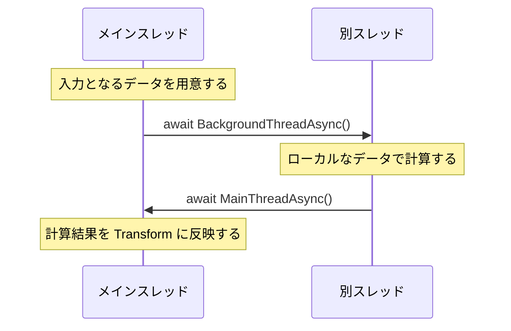

# 補足：Unity のメインスレッドと別スレッド

コルーチンや `await` で待っている間も、Unity はほかの処理を進められます。では、待っていた処理は別のスレッドで動いているのでしょうか。スレッド ID をログに出して、フレームをまたぐ待機と、別スレッドでの実行を区別し、既習の `Task.Run` との関係も整理します。

## 学習目標

- `Start`、`Update`、待機の前後のスレッド ID を比較できる
- コルーチンや `async` / `await` を使うだけでは、計算が別スレッドへ移らないことを説明できる
- `Task.Run` と `BackgroundThreadAsync` の共通点と、実行範囲・戻り方の違いを説明できる
- 別スレッドで計算し、メインスレッドに戻って GameObject に結果を反映できる
- 破棄やアプリの終了を、バックグラウンドの計算にも伝えられる

## 前提知識

- [Awaitable と async / await](/unity-csharp-learning/unity/awaitable/) を読んでいること
- [スレッドの基本](/unity-csharp-learning/csharp/threads/) を読んでいること
- [Task と Task\<T\>](/unity-csharp-learning/csharp/tasks/) を読んでいること

このページは、スレッドを使用できるデスクトップ環境の Unity Editor で確認します。

---

## 1. Start と Update のスレッド ID を調べる

Unity は、フレームごとのゲームの処理を進めるために**メインスレッド**を使います。`Start` や `Update` も、このスレッドから呼ばれます。まず、この 2 つの実行場所を比べます。

**書式：[Environment.CurrentManagedThreadId プロパティ](https://learn.microsoft.com/dotnet/api/system.environment.currentmanagedthreadid)**

```csharp
public static int CurrentManagedThreadId { get; }
```

現在のコードを実行している、マネージドスレッドの ID を取得します。ID はスレッドを区別するための番号です。CPU のコア番号や、処理の優先順位を表す値ではありません。

空のゲームオブジェクトに、動作確認用の `SampleThreads` スクリプトを作成してアタッチします。

```csharp
using System;
using UnityEngine;

public class SampleThreads : MonoBehaviour
{
    private bool _hasLoggedUpdate;

    private void Start()
    {
        Debug.Log($"Start: スレッド {Environment.CurrentManagedThreadId}");
    }

    private void Update()
    {
        if (_hasLoggedUpdate) return;
        _hasLoggedUpdate = true;
        Debug.Log($"Update: スレッド {Environment.CurrentManagedThreadId}");
    }
}
```

実行結果の例です。ID の値は環境や実行によって変わりますが、2 行の ID は同じになります。以降の出力例も、番号そのものではなく、同じか違うかを比べてください。

```
Start: スレッド 1
Update: スレッド 1
```

`Update` は毎フレーム呼ばれるため、`_hasLoggedUpdate` で最初の 1 回だけ表示しています。以降も、各例の最初のログをメインスレッドの ID として比較します。別の実行で同じ番号になることを前提にはしません。

---

## 2. コルーチンは別スレッドを作らない

コルーチンでは、待っている間にも `Update` が呼ばれました。これは、別スレッドでコルーチンを動かしているからではありません。コルーチンが処理を中断して Unity に制御を戻し、Unity が後のフレームで続きを実行するためです。

`SampleThreads` の全体コードを、コルーチンの前後で ID を表示する例にします。

```csharp
using System;
using System.Collections;
using UnityEngine;

public class SampleThreads : MonoBehaviour
{
    private IEnumerator Start()
    {
        Debug.Log($"待機前: スレッド {Environment.CurrentManagedThreadId}");
        yield return null;
        Debug.Log($"待機後: スレッド {Environment.CurrentManagedThreadId}");
    }
}
```

実行結果の例です。2 行は別のフレームに表示されますが、スレッド ID は同じです。

```
待機前: スレッド 1
待機後: スレッド 1
```

コルーチンの中に時間のかかる計算を書けば、その計算はメインスレッドを使い続けます。`yield return` に到達するまで Unity に制御を戻さないため、計算をコルーチンに移すだけでは、フレームの停止を防げません。[Unity のコルーチンの説明](https://docs.unity3d.com/Manual/Coroutines.html)でも、コルーチンとスレッドは異なるものとして説明されています。

---

## 3. await しても、自動で別スレッドになるわけではない

`async` は、メソッドの中で `await` を使えるようにする修飾子です。「このメソッドを別スレッドで動かす」という指定ではありません。前のページで使った `Awaitable.NextFrameAsync` の前後を比べます。

```csharp
using System;
using UnityEngine;

public class SampleThreads : MonoBehaviour
{
    private async void Start()
    {
        Debug.Log($"await 前: スレッド {Environment.CurrentManagedThreadId}");
        await Awaitable.NextFrameAsync();
        Debug.Log($"await 後: スレッド {Environment.CurrentManagedThreadId}");
    }
}
```

実行結果の例です。この例もフレームをまたぎますが、ID は変わりません。

```
await 前: スレッド 1
await 後: スレッド 1
```

`await` は待機中に呼び出し元へ制御を戻し、待機が終わると続きを実行します。続きがどのスレッドで動くかは、待っている処理や、その処理が持つ再開の仕組みによって決まります。この例ではメインスレッドから `NextFrameAsync` を待ち、次のフレームもメインスレッドで再開しています。

---

## 4. 明示的に別スレッドへ移る

大量の数値を集計するなど、待つのではなく計算そのものに時間がかかる場合があります。その計算をメインスレッドで続けると、その間はフレームの処理を進められません。Unity のオブジェクトを操作しない計算なら、別スレッドで行い、メインスレッドを空ける方法があります。

**書式：[Awaitable.BackgroundThreadAsync メソッド](https://docs.unity3d.com/ScriptReference/Awaitable.BackgroundThreadAsync.html)**

```csharp
public static BackgroundThreadAwaitable BackgroundThreadAsync();
```

`await` すると、メソッドの続きをスレッドプールのバックグラウンドスレッドで実行します。呼び出すたびに専用のスレッドを新しく作る、という意味ではありません。

**書式：[Awaitable.MainThreadAsync メソッド](https://docs.unity3d.com/ScriptReference/Awaitable.MainThreadAsync.html)**

```csharp
public static MainThreadAwaitable MainThreadAsync();
```

`await` すると、メソッドの続きを Unity のメインスレッドで実行します。次の例では、同じ `Start` メソッドの途中で実行場所を切り替えます。

```csharp
using System;
using UnityEngine;

public class SampleThreads : MonoBehaviour
{
    private async void Start()
    {
        Debug.Log($"切り替え前: スレッド {Environment.CurrentManagedThreadId}");

        await Awaitable.BackgroundThreadAsync();
        Debug.Log($"別スレッド: スレッド {Environment.CurrentManagedThreadId}");

        int total = 0;
        for (int i = 1; i <= 100; i++)
        {
            total += i;
        }

        await Awaitable.MainThreadAsync();
        Debug.Log($"戻った後: スレッド {Environment.CurrentManagedThreadId}, 合計 {total}");
    }
}
```

実行結果の例です。中央の ID だけが異なり、最後は最初の ID に戻ります。合計は毎回 `5050` です。

```
切り替え前: スレッド 1
別スレッド: スレッド 12
戻った後: スレッド 1, 合計 5050
```

計算中に `total` を使うのは、このメソッドだけです。`await MainThreadAsync()` の後でも、ローカル変数の値は引き継がれます。計算結果を別のフィールドへ置き、`Update` で完了を監視する必要はありません。

ここで使う `Debug.Log` は別スレッドからもログを出せます。ただし、このことから、ほかの Unity API も別スレッドで使えるとは判断できません。ログの引数を作るときに `transform.position` を読むことも、その Unity API を呼ぶ操作です。

---

## 5. Task.Run と何が違うのか

[Task と Task\<T\>](/unity-csharp-learning/csharp/tasks/)では、`Task.Run` で計算をスレッドプールに渡しました。4 節の計算も、同じように書けるのでしょうか。

**この合計計算は、`Task.Run` でも書けます。** `Task.Run` と `BackgroundThreadAsync` は、どちらもスレッドプールを使います。Unity 専用の、GameObject を自由に操作できるスレッドが用意されるわけではありません。違いは、別スレッドで動かす処理をどう区切るかと、その後の実行場所をどう決めるかです。

### 同じ計算を Task.Run で書く

**書式：[Task.Run メソッド](https://learn.microsoft.com/dotnet/api/system.threading.tasks.task.run)**

```csharp
public static Task<TResult> Run<TResult>(Func<TResult> function);
```

| パラメータ・戻り値 | 説明 |
|---|---|
| `function` | スレッドプールで実行する処理 |
| 戻り値 | 処理の完了と、`TResult` 型の結果を表す `Task<TResult>` |

`SampleThreads` の全体コードです。4 節と同じく、1 から 100 までの合計と、計算前・計算中・計算後のスレッド ID を表示します。

```csharp
using System;
using System.Threading.Tasks;
using UnityEngine;

public class SampleThreads : MonoBehaviour
{
    private async void Start()
    {
        Debug.Log($"Task.Run 前: スレッド {Environment.CurrentManagedThreadId}");

        int total = await Task.Run(() =>
        {
            Debug.Log($"Task.Run 内: スレッド {Environment.CurrentManagedThreadId}");
            int sum = 0;
            for (int i = 1; i <= 100; i++)
            {
                sum += i;
            }
            return sum;
        });

        Debug.Log($"Task.Run 後: スレッド {Environment.CurrentManagedThreadId}, 合計 {total}");
    }
}
```

実行結果の例です。ID の値は変わりますが、この例も中央だけが別の ID となり、合計は `5050` になります。

```
Task.Run 前: スレッド 1
Task.Run 内: スレッド 12
Task.Run 後: スレッド 1, 合計 5050
```

`Task.Run` に渡したラムダ式の中だけが、スレッドプールで実行されます。`return sum;` の結果を `Task<int>` が受け持ち、呼び出し元は `await` でその結果を受け取ります。4 節の例は、同じメソッドの続きを別スレッドへ移し、後からメインスレッドへ戻す書き方でした。

### MainThreadAsync がなくても戻る理由

このコードでは、メインスレッドで呼ばれる `Start` の中から `Task` を `await` しています。Unity はメインスレッドに **UnitySynchronizationContext** という同期コンテキストを設定しており、通常の `await` はそのコンテキストを使って続きを再開します。そのため、ラムダ式が別スレッドで完了しても、`await` の後はメインスレッドで実行されます。

未完了の `Task` を待つ場合の流れです。別スレッドへ渡すのは計算処理であり、`Start` の続きは Unity の同期コンテキストを通じてメインスレッドで再開します。



ただし、「どこからでも `Task` を待てばメインスレッドへ戻る」という意味ではありません。別スレッドから待つ場合や、`ConfigureAwait(false)` で元のコンテキストへ戻す指定を外した場合には、メインスレッドで再開する保証はありません。`ConfigureAwait(false)` は、必ず別スレッドへ移す指定でもありません。詳しくは [await の前後で実行されるスレッド](/unity-csharp-learning/csharp/await-threads/)を参照してください。

また、`await` に到達した時点で `Task` が完了していれば、中断せずにその場で続きます。短い計算のログだけから「必ず次のフレームで戻る」とは判断できません。

### Task.Run・Awaitable・Thread の使い分け

| 書き方 | 別スレッドで動かす範囲 | 計算後の実行場所 |
|---|---|---|
| `Task.Run` | 引数に渡した処理。スレッドプールで実行する | 呼び出し元の `await` が同期コンテキストなどに従って再開する。このページの例ではメインスレッド |
| `BackgroundThreadAsync` | 同じメソッドの、その `await` より後の処理。スレッドプールで実行する | 同じメソッド内で `MainThreadAsync` を待ち、メインスレッドへ戻せる |
| `Thread` | 自分で作成したスレッドに渡した処理 | スレッドの処理が終わっても、Unity のメインスレッドで続きが自動実行されるわけではない |

計算をひとまとまりの処理に分け、結果を `await` で受け取りたい場合は `Task.Run` で表せます。Unity のフレーム待ちなどと組み合わせ、同じメソッド内で実行場所を切り替えたい場合は `Awaitable` で表せます。既存の .NET の処理が `Task` を返していれば、それを Unity から `await` することもできます。`Task.Run` を使った計算を、必ず `Awaitable` で書き直す必要はありません。

`Thread` は専用のスレッドを自分で作成・管理する仕組みです。ここで行うような計算のために、毎回専用スレッドを作る必要はありません。`Task.Run` も `BackgroundThreadAsync` も、その管理をスレッドプールに任せています。

なお、表の Awaitable の説明は、4 節のように**同じメソッド内**で切り替える場合のものです。子の async メソッド内でスレッドを切り替えたからといって、呼び出し元の続きも必ず同じスレッドになるとは限りません。戻り先は、呼び出し元が何をどこから `await` するかも含めて考えます。Unity 側の仕組みは、[Awaitable の完了と継続](https://docs.unity3d.com/6000.4/Documentation/Manual/async-awaitable-continuations.html)を参照してください。

---

## 6. GameObject の操作はメインスレッドで行う

**GameObject や Transform などを操作する、ほとんどの Unity API はスレッドセーフではありません。** Unity がシーンの状態を更新している間に、別スレッドからもその状態を読み書きできる仕組みにはなっていないため、メインスレッドから使う必要があります。値の書き換えだけでなく、`transform.position` を読むことや、`GetComponent` を呼ぶことにも注意が必要です。

これは `Task.Run`、`BackgroundThreadAsync`、`Thread` のどれを使っても同じです。`Task.Run` の例では、計算中のラムダ式で GameObject に触れず、メインスレッドで再開した後に結果を反映します。

`lock` で自分のコード同士を排他制御しても、Unity 内部の処理まで同じロックを使うわけではありません。メインスレッドから使うという API の条件は変わりません。

そのため、計算とオブジェクトの操作を次のように分けます。



別スレッドで必要な値は、切り替える前にメインスレッドで読み、計算用のデータとして渡します。配列を使う場合も、計算中にメインスレッドから同じ配列を書き換えれば競合が起きます。データのコピーを渡すなど、計算中に誰がそのデータを使うかも決める必要があります。

Editor では、別スレッドからの Unity API 呼び出しが「メインスレッドからしか呼べない」という例外になることがあります。例外が出なかった場合も、安全に使える保証にはなりません。詳しくは [Unity の Awaitable とスレッドの説明](https://docs.unity3d.com/6000.4/Documentation/Manual/async-awaitable-continuations.html)を参照してください。

---

## 7. 実例：計算結果をオブジェクトの位置に反映する

複数の X 座標の平均を求め、その位置へ球体を移動させます。計算中は数値だけを扱い、位置の変更はメインスレッドへ戻ってから行います。信号機のように時間や入力を待つだけの処理を、別スレッドへ移す必要はありません。

**GameObject → 3D Object → Sphere** で球体を追加し、Position を `(0, 0, 0)` にします。球体に `SampleThreadPosition` スクリプトを作成してアタッチします。

### アプリや Play モードの終了にも備える

メインスレッドから離れた処理も、アプリや Play モードが終了したら不要になります。Unity は、開始済みのバックグラウンドの計算を自動で打ち切るわけではありません。処理を続ける期間に合ったトークンを、切り替える前に取得します。

**書式：[Application.exitCancellationToken プロパティ](https://docs.unity3d.com/ScriptReference/Application-exitCancellationToken.html)**

```csharp
public static CancellationToken exitCancellationToken { get; }
```

Play モードの終了時、またはアプリの終了時にキャンセルされるトークンです。次の全体コードでは、コンポーネントの破棄とアプリの終了を、1 つのソースに結び付けます。計算中と結果を反映する前に、キャンセルされていないかを調べます。

```csharp
using System;
using System.Threading;
using UnityEngine;

public class SampleThreadPosition : MonoBehaviour
{
    private async void Start()
    {
        using var source = CancellationTokenSource.CreateLinkedTokenSource(
            destroyCancellationToken, Application.exitCancellationToken);
        CancellationToken token = source.Token;
        float[] positions = { 1f, 2f, 3f };
        Debug.Log($"準備: スレッド {Environment.CurrentManagedThreadId}");

        await Awaitable.BackgroundThreadAsync();
        Debug.Log($"計算: スレッド {Environment.CurrentManagedThreadId}");

        float total = 0f;
        foreach (float x in positions)
        {
            if (token.IsCancellationRequested) return;
            total += x;
        }
        float average = total / positions.Length;

        await Awaitable.MainThreadAsync();
        if (token.IsCancellationRequested) return;

        transform.position = new Vector3(average, 0f, 0f);
        Debug.Log($"反映: スレッド {Environment.CurrentManagedThreadId}, X = {average}");
    }
}
```

`positions` は、この処理だけが使う計算用の配列です。平均を求める間は GameObject に触れません。`transform.position` への代入は、`await MainThreadAsync()` の後に置いています。

`destroyCancellationToken` と `Application.exitCancellationToken` も、切り替え前に取得します。計算中に破棄や終了の要求に気付いた場合は、そのまま終了します。メインスレッドへ戻るまでにキャンセルされていた場合も、結果の反映を取りやめます。`using` は、この実行が終了するときにソースを破棄するためのものです。

トークンを取得しただけでは計算は止まりません。この例はループの各回で確認しています。長い計算では、キャンセルを確認する間隔によって、終了までの時間も変わります。途中で例外を投げて抜け、`catch` や `finally` で対応する方法は、[キャンセル](/unity-csharp-learning/csharp/task-cancellation/)を参照してください。

この例の計算量は、実行場所を確認できるよう小さくしています。スレッドの切り替えにもコストがあるため、短い計算を移すだけでは速くなるとは限りません。

## 動作確認

実行結果の例です。ID は実行によって変わりますが、「準備」と「反映」は同じ ID、「計算」は異なる ID になります。X 座標の平均は `(1 + 2 + 3) / 3` なので、毎回 `2` です。

```
準備: スレッド 1
計算: スレッド 12
反映: スレッド 1, X = 2
```

Play 中に球体を選択し、Inspector の Transform で Position が `(2, 0, 0)` になっていることを確認します。最小例の `SampleThreads` は外しておくと、この 3 行だけを比べられます。


---

## まとめ

- コルーチンの中断や `await` による待機は、別スレッドでの計算とは異なる
- `BackgroundThreadAsync` と `MainThreadAsync` で、同じメソッドの続きを実行するスレッドを切り替えられる
- `Task.Run` でも計算をスレッドプールへ渡せる。渡した処理の実行場所と、`await` 後の再開場所を区別する
- GameObject や Transform の操作はメインスレッドで行う
- 別スレッドでは計算用のデータを扱い、メインスレッドへ戻ってから結果を反映する

## 理解度チェック

1. コルーチンの中の長い計算でフレームが止まるのはなぜですか？
2. `NextFrameAsync` の前後でスレッド ID が同じでも、`await` で待機できているのはなぜですか？
3. `Debug.Log` が別スレッドで使えた場合、`transform.position` も同じように使えると判断できますか？
4. 別スレッドで計算するために `transform.position.x` が必要な場合、どこで読み取ればよいですか？
5. 5 節の `Task.Run` の例では、`MainThreadAsync` がないのに、最後のログがメインスレッドで表示されるのはなぜですか？

<details markdown="1">
<summary>解答を見る</summary>

1. コルーチンもメインスレッドで実行され、次の `yield return` に到達するまで制御を戻さないためです。
2. メソッドを中断して Unity に制御を戻し、次のフレームに同じメインスレッドで再開するためです。
3. 判断できません。API ごとに使えるスレッドが決まっていて、Transform の操作はメインスレッドで行う必要があります。
4. 別スレッドへ切り替える前にメインスレッドで読み取り、計算用の値として渡します。
5. Unity のメインスレッドから通常の `await` で待っており、Unity の同期コンテキストを使って再開するためです。`Task` がすでに完了していれば、そのメインスレッドで中断せずに続きます。`Task.Run` のラムダ式自体がメインスレッドで動くわけではありません。

</details>

## 次のステップ

[複数の処理を開始して待つ](/unity-csharp-learning/unity/concurrent-operations/)では、順番に開始する処理と、先に複数を開始してから待つ処理を比較します。同時進行と別スレッドでの計算を区別する考え方を使います。
